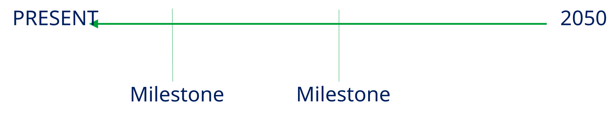

La retroproyección (*backcasting*) es una forma de conectar un futuro dado con el presente y de superar el "sesgo del presente" en nuestra manera de planificar. Es una herramienta para determinar los pasos que deben darse para llegar a un futuro preferido.

### Úsela para…

- Construir una línea de tiempo que vaya hacia atrás, desde un futuro preferido hasta el presente, señalando los cambios clave.
- Crear un plan realista y alcanzable, obligándose a pensar en todos los pasos en lugar de concentrarse solo en la meta final.
- Identificar qué está bajo el control del equipo de política y qué queda fuera de su control y, por tanto, debe gestionarse.
- Superar el deseo de buscar ganancias inmediatas en lugar de ganancias a largo plazo (el "sesgo del presente").
- Poner a prueba la viabilidad de un enfoque particular dentro de un futuro particular, lo que le ayuda a pensar las medidas de política necesarias para llegar a un punto final preferido.

### Obtendrá…

Un plan de acción para lograr los futuros deseados, con una línea de tiempo que llega hasta el presente.

### Tenga cuidado con…

Muchos factores pueden resultar fuera de su control. Inclúyalos de todas formas para asegurarse de que su visión del entorno de política o de estrategia sea completa.

### A quién involucrar

- Personas con interés en el área de política.
- Piense en incluir a otros actores que deben participar para que el "futuro preferido" se haga realidad.

### Número de participantes

Entre 8 y 16 personas le permitirán concentrarse mejor en el debate de política. Si tiene suficientes facilitadores, divídalas en grupos más pequeños para que cada participante pueda aportar más.

### Tiempo que toma

De 4 a 5 horas repartidas en dos talleres, más algo de tiempo para preparar antes y para redactar el plan de acción.

### Cómo incluir más perspectivas

La retroproyección puede usarse para involucrar a una comunidad en la reflexión sobre el futuro y para construir un propósito compartido.

### El enfoque

#### Hay siete pasos:

#### Paso 1

Presentar el futuro preferido.

#### Paso 2

Identificar las diferencias clave entre el presente y el futuro preferido.

#### Paso 3

Construir una línea de tiempo.

#### Paso 4

Identificar qué cambios puede controlar y cuáles no.

#### Paso 5

Identificar qué necesita hacer para ejecutar los pasos que están bajo su control.

#### Paso 6

Identificar cómo puede influir en los pasos que están fuera de su control.

#### Paso 7

Desarrollar el plan de acción.

### Paso 1: Presente el futuro preferido

(Tiempo estimado para completar este ejercicio: 30 minutos).

Presente el futuro preferido, que puede haberse desarrollado en su ejercicio de [escenarios](escenarios.qmd) o estar informado por un ejercicio de [construcción de visión](vision.qmd).

### Paso 2: Identifique las diferencias clave entre el presente y el futuro preferido

(Tiempo estimado para completar este ejercicio: 60 minutos).

Pida a sus participantes que describan las diferencias clave entre:

- dónde están ahora y dónde estarán en el futuro preferido;
- qué impulsa el cambio ahora y qué lo impulsará en el futuro preferido;
- el entorno de ejecución de las políticas ahora y en el futuro preferido.

Use un enfoque como PESTLE (factores políticos, económicos, sociales, tecnológicos, legislativos y ambientales) para asegurarse de captar las diferencias en cada categoría.

### Paso 3: Construya una línea de tiempo con los cambios clave necesarios para pasar del futuro preferido a la realidad presente

(Tiempo estimado para completar este ejercicio: 40 a 50 minutos).

- Anote los acontecimientos y pasos necesarios para retroceder desde el futuro preferido hasta la realidad presente. ¿Qué tuvo que ocurrir? ¿Qué tuvo que ocurrir antes para hacerlo posible?
- Ubique estos acontecimientos en una línea de tiempo.
- Identifique los acontecimientos críticos que deben ocurrir para que el futuro preferido se haga realidad.

### Paso 4: Identifique los cambios que puede controlar y los que no

(Tiempo estimado para completar este ejercicio: 40 minutos).

Califique los acontecimientos críticos:

1. este acontecimiento está totalmente bajo nuestro control;
2. este acontecimiento está parcialmente bajo nuestro control;
3. este acontecimiento está totalmente fuera de nuestro control.

### Paso 5: Identifique qué necesita hacer para ejecutar los pasos que están bajo su control

(Tiempo estimado para completar este ejercicio: 40 minutos).

Para los acontecimientos críticos que están total o parcialmente bajo su control, identifique:

- qué impacto tendrá el acontecimiento en el logro del futuro preferido;
- quién se beneficiará o perderá si el acontecimiento ocurre;
- qué se beneficiará o perderá si el acontecimiento ocurre (por ejemplo, el ambiente, la biodiversidad, la seguridad global);
- quién perderá, o puede sentir que va a perder;
- qué tan cierto es que el acontecimiento ocurrirá;
- los facilitadores que le harán más fácil lograr que el acontecimiento ocurra;
- las barreras que puede tener que superar para lograr que el acontecimiento ocurra;
- los pasos clave que necesita dar ahora.

### Paso 6: Identifique cómo puede influir en los pasos que están fuera de su control

(Tiempo estimado para completar este ejercicio: 30 minutos).

Para los acontecimientos que están totalmente fuera de su control, identifique:

- quién tiene el control;
- el impacto de que el acontecimiento no ocurra;
- en qué puede influir para aumentar la probabilidad de que el acontecimiento ocurra, y los pasos clave que tendría que dar.

### Paso 7: Desarrolle el plan de acción

Resuma sus hallazgos y desarrolle un plan de acción, teniendo en cuenta todos los productos de los pasos anteriores.

### ¿Necesita ahorrar tiempo?

Un ejercicio rápido de retroproyección puede usarse como parte de un taller de estrategia o de escenarios. Puede hacerlo en unos 90 minutos con una línea de tiempo preparada de antemano.

Forme dos grupos con sus participantes. Un grupo parte del presente y crea una línea de tiempo de los acontecimientos clave que tendrían que ocurrir para llegar al futuro preferido. El segundo construye la línea de tiempo desde el futuro hacia atrás, hasta el presente. Este ejercicio funciona mejor cuando los grupos no miran la pared o la pizarra del otro hasta que se acaba el tiempo. Una media hora debería bastar.

Después de 30 minutos, los grupos ven los tableros del otro. ¿Cuáles son las diferencias y las similitudes? Si tiene tiempo, también puede hacer algunas de las preguntas del paso 5.

Fusionar las dos líneas de tiempo en una identificará los puntos clave de decisión. Este enfoque puede dar energía a un taller con un grupo nuevo en el pensamiento de futuros. Mirar hacia adelante y hacia atrás, y examinar las diferencias entre ambas miradas, puede ofrecer una visión rica del camino hacia un futuro preferido.

### Estudio de caso

La Mineral Products Association (MPA, asociación de productos minerales) desarrolló una visión de éxito para su organización, buscando aumentar su capacidad y su impacto. La MPA usó un ejercicio de retroproyección con líderes de la industria, tanto de alto nivel como jóvenes, para identificar y acordar los pasos necesarios para lograr la visión y los papeles que debían desempeñar los distintos actores de la industria, incluida la MPA, para asegurar su logro. El ejercicio ayudó a identificar nuevas prioridades estratégicas para la asociación y condujo a la publicación de una nueva carta: *Driving Change, Raising Standards and Improving Perceptions* ("Impulsar el cambio, elevar los estándares y mejorar las percepciones").

**Los recursos para esta herramienta están en el [Banco de recursos](https://www.gov.uk/government/publications/futures-toolkit-resources-for-government-officials). Los estudios de caso están en el [Banco de estudios de caso](https://www.gov.uk/government/publications/futures-tools-and-methods-case-studies).**
