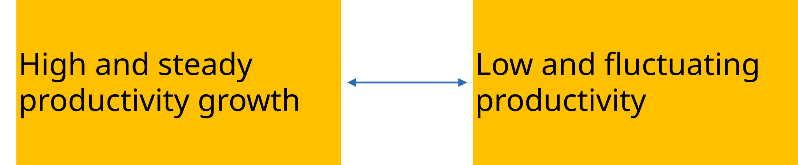
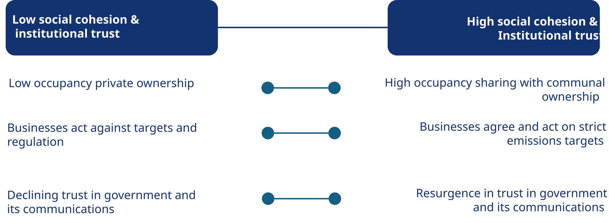
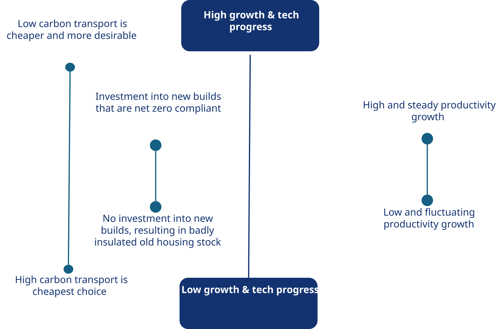

Los escenarios son relatos convincentes sobre un abanico de futuros posibles distintos. Describen mundos futuros para que las personas puedan entender cómo se sentiría vivir en ellos y qué significarían para ellas. Puede usar escenarios para explorar las implicaciones de muchos futuros distintos para usted, sus actores y su proyecto o política.

### Úsela para…

- Explorar las formas en que un área de política particular podría tener que desarrollarse en distintos futuros posibles.
- Considerar cómo podrían comportarse los actores clave (gobierno, empresas, ciudadanos) en condiciones distintas.
- Trabajar e identificar los requisitos clave de las políticas en distintos futuros posibles.
- Construir una comprensión compartida de las dinámicas de cambio.
- Ensayar decisiones y disyuntivas futuras.
- Comprender las distintas oportunidades y amenazas en futuros diferentes.

### Obtendrá…

- Narrativas de un abanico de futuros posibles distintos.
- Una representación visual del abanico de futuros posibles que puede explicarse fácilmente a otras personas.

### Tenga cuidado con…

- La construcción de escenarios permite a las personas explorar distintos futuros posibles. Es muy probable que cuestionen el *statu quo*, así que facilitarlos exige cuidado.
- La experiencia previa en la facilitación de ejercicios de futuros es especialmente útil para esta herramienta.
- Siempre hay más escenarios de los que razonablemente puede incluir en un ejercicio: elegir algunos que sean lo bastante distintos e interesantes es tanto un arte como una ciencia.
- Piense con cuidado en la comunicación: los escenarios deben presentarse como varios futuros posibles, no como un plan. Los escenarios no son planes ni predicciones del futuro; algunos elementos de sus escenarios ocurrirán y otros no.

### A quién involucrar

- Personas con interés en el área de política.
- Personas con interés en explorar futuros posibles.

### Número de participantes

La construcción de escenarios requiere un mínimo de 8 a 12 personas. Los grupos más grandes y diversos son los mejores para asegurar que los escenarios sean ricos y robustos. Los grupos más grandes requerirán varios facilitadores.

### Tiempo que toma

Al menos 4 a 5 horas para el taller, posiblemente divididas en varias sesiones. Si hace los talleres de forma virtual, serán como mínimo 6 horas y habrá que dividirlas en más de una sesión. El tiempo necesario para redactar o ilustrar sus escenarios dependerá del enfoque que adopte.

### Cómo incluir más perspectivas

- Los escenarios están entre las herramientas de futuros más atractivas y, bien hechos, pueden funcionar con un abanico amplio de grupos de participantes, incluso en ejercicios de participación pública.
- Use técnicas [experienciales](futuros-experienciales.qmd) para dar vida a sus escenarios y ayudar a grupos de fuera de su organización a involucrarse con ellos. Sus respuestas podrían informar su proceso de futuros más amplio.

### El enfoque

Las personas tienden a pensar en la incertidumbre como un factor negativo que reduce su capacidad de "ver" el futuro. Los escenarios usan las incertidumbres de forma positiva para crear múltiples futuros posibles.

Los escenarios no son predicciones; no son buenos ni malos, ni equivocados ni correctos. Ofrecen imágenes del futuro interesantes, a menudo desafiantes y a veces polémicas. Ofrecen un espacio seguro para explorar formas alternativas en que podría desarrollarse un área de política y, por tanto, las decisiones que distintos actores podrían tomar en distintos futuros posibles.

Ningún escenario futuro se hará realidad por completo, pero es probable que sí lo hagan partes de distintos futuros. Trabajar sus escenarios le ayudará a reconocer las señales de alerta temprana cuando aparezcan.

Los escenarios deben situarse a una distancia razonable en el futuro: al menos cinco años, aunque por lo general un mínimo de 10 a 20 años.

Hay distintas formas de crear escenarios. En esta herramienta describimos el enfoque de la matriz de escenarios de 2 × 2, pero en otra parte de la caja de herramientas encontrará dos enfoques alternativos: los [escenarios morfológicos y los arquetipos de escenarios](otros-escenarios.qmd). Necesitará como insumo para la herramienta de escenarios una lista de impulsores importantes y muy inciertos (las incertidumbres críticas), obtenida con la herramienta de [Mapeo de impulsores](mapeo-impulsores.qmd).

#### Hay cinco pasos

(Tiempo estimado para completar este ejercicio: 45 a 60 minutos).

#### Paso 1

Desarrollar los ejes de incertidumbre.

#### Paso 2

Describir cómo es el mundo en cada escenario futuro.

#### Paso 3

Nombrar los escenarios futuros.

#### Paso 4

Presentación y discusión en plenaria.

#### Paso 5

Redactar los escenarios.

### Paso 1: Desarrolle los ejes de incertidumbre

- Primero trabaje con su lista larga de incertidumbres críticas, elaborada con la herramienta de Mapeo de impulsores. Use las incertidumbres críticas priorizadas del cuadrante superior derecho del mapa de impulsores (procure un mínimo de 10 incertidumbres críticas).
- Se trata de crear un continuo entre dos desenlaces inciertos opuestos: las formas en que podría desarrollarse un impulsor. No son necesariamente positivos o negativos; son solo los extremos de la incertidumbre. Explore distintas formas de describir los desenlaces y elija la mejor para su propósito. Por ejemplo, la "productividad" podría describirse así:

- Agrupe sus ejes en dos categorías. Las categorías deben ser independientes entre sí. Así se asegura de que sus dos ejes sean lo bastante distintos para darle un conjunto de escenarios interesante y contrastante. Por ejemplo, podría contraponer cambios tecnológicos y cambios sociales.
- Discuta qué incertidumbres serán las más importantes para sus actores y para su área de política o de estrategia. Puede que dos destaquen como las dominantes, o puede crear ejes de incertidumbre generales a partir de un grupo.
- Estos serán los ejes de su matriz de escenarios de 2 × 2, sobre la que construirá sus cuatro escenarios futuros.

### Estudio de caso

#### Los ejes del proyecto *Net Zero Society* de GO-Science

Es una imagen compleja, con muchos recuadros y líneas. En la sección superior, el eje horizontal va de "Baja cohesión social y confianza institucional" a "Alta cohesión social y confianza institucional", con tres subejes: de "Propiedad privada de baja ocupación" a "Uso compartido de alta ocupación con propiedad comunal"; de "Las empresas actúan en contra de las metas y la regulación" a "Las empresas aceptan metas de emisiones estrictas y actúan en consecuencia"; y de "Confianza decreciente en el Gobierno y sus comunicaciones" a "Resurgimiento de la confianza en el Gobierno y sus comunicaciones". En la sección inferior, el eje vertical principal va de "Alto crecimiento y progreso tecnológico" a "Bajo crecimiento y progreso tecnológico", con tres subejes: de "El transporte bajo en carbono es más barato y deseable" a "El transporte alto en carbono es la opción más barata"; de "Inversión en construcciones nuevas que cumplen con las cero emisiones netas" a "Ninguna inversión en construcciones nuevas, lo que deja un parque de viviendas antiguas mal aisladas"; y de "Crecimiento alto y sostenido de la productividad" a "Crecimiento bajo y fluctuante de la productividad".

### Estudio de caso

La matriz de 2 × 2 del proyecto *Net Zero Society* de GO-Science.

### Paso 2: Describa cómo es el mundo

(Tiempo estimado para completar este ejercicio: 80 a 120 minutos).

Los participantes deben llenar cada cuadrante (recordando incluir los resultados de su [Escaneo del horizonte](escaneo-horizonte.qmd) y de otras investigaciones), considerando:

- ¿Cuáles son algunas de las características clave de cada futuro?
- ¿En qué sería diferente la vida de la de hoy? Piense con la mayor amplitud posible: ¿qué pasa con el trabajo, los desplazamientos, la educación, el ocio, las compras, la economía, la política, el ambiente y el clima, las relaciones internacionales? ¿Qué más?

Cada participante debe pasar por los cuatro cuadrantes durante el ejercicio.

### Paso 3: Nombre los escenarios futuros

(Tiempo estimado para completar este ejercicio: 30 minutos).

Pida a los participantes que piensen un nombre para cada escenario. Los nombres deben captar la esencia de cada escenario, ser evocadores y destacar lo que los distingue. Debe haber un tema común. Tenga cuidado de no sesgar los nombres (es decir, no dé un nombre positivo al escenario que prefiere y uno negativo al que no).

**Los escenarios del [proyecto de prospectiva *Net Zero Society*](https://www.gov.uk/government/publications/net-zero-society-scenarios-and-pathways--2) se llamaron: *Slow Lane Society* (sociedad del carril lento), *Self-Preservation Society* (sociedad de la autopreservación), *Metropolitan Society* (sociedad metropolitana) y *Atomised Society* (sociedad atomizada).**

### Paso 4: Presentación y discusión en plenaria

(Tiempo estimado para completar este ejercicio: 80 a 120 minutos).

Para cada escenario futuro:

- ¿Qué le sorprendió?
- ¿Cuáles fueron las similitudes y diferencias entre los escenarios?
- ¿Cuáles fueron sus principales aprendizajes del ejercicio en general?

### Paso 5: Redacte los escenarios

Después del taller, tendrá que redactar los cuatro escenarios para poder compartirlos. Puede ser una narrativa breve, o puede querer hacer más trabajo para añadir detalle. En el ejemplo de *Net Zero Society*, los escenarios se usaron como punto de partida para un conjunto de modelos cuantitativos.

Para dar vida a sus escenarios y ayudar a las personas a involucrarse con ellos, podría usar algunos de los métodos de [futuros experienciales](futuros-experienciales.qmd), como los relatos, los titulares de prensa o "Un día en la vida de". En el proyecto de [prospectiva *Net Zero Society*](https://www.gov.uk/government/publications/net-zero-society-scenarios-and-pathways--2), los escenarios se usaron como base de un ejercicio de participación pública.

### Siguientes pasos

Los escenarios suelen usarse como parte de un proceso de futuros más amplio. Por ejemplo, pueden ser la base de las [Pruebas de estrés de políticas](pruebas-estres.qmd).

Según el objeto del ejercicio, puede considerar uno o ambos de los siguientes: entender los impactos en los actores e identificar las principales recomendaciones y temas.

### Impactos en los actores: qué significa esto para usted, sus actores y su área de política

Piense en qué significa cada escenario para sus actores. Algunas preguntas que puede hacer son:

Dadas las características y condiciones de cada futuro…

- ¿Qué significa esto para usted, sus actores y su política o estrategia?
- Considere las características en formato [FODA](foda.qmd):
   - ¿Cuáles son nuestras fortalezas en política o estrategia para este futuro?
   - ¿Cuáles son nuestras debilidades en política o estrategia para este futuro?
   - ¿Cuáles son las oportunidades que la política o estrategia debe facilitar?
   - ¿Cuáles son las amenazas que la política o estrategia debe mitigar?

### Identifique las principales recomendaciones y temas para desarrollar la política o estrategia

Este paso tiende el puente entre el futuro descrito en cada escenario y el reto actual de política o de estrategia.

- Suponga que está en este futuro.
- A partir de esta conversación, ¿qué tres recomendaciones haría para asegurar que la política o estrategia cumpla sus objetivos?

En esta etapa puede aplicar la herramienta de [Pruebas de estrés de políticas](pruebas-estres.qmd).

Puede usar estas recomendaciones como insumo de un ejercicio de [Hojas de ruta](hojas-ruta.qmd).

### Estudio de caso

El proyecto *Net Zero Society* de GO-Science se encargó en 2021 como parte de la estrategia de cero emisiones netas del Gobierno. El proyecto consistió en desarrollar un conjunto de escenarios plausibles para ampliar la reflexión sobre cómo podría cambiar la sociedad hacia 2050. Varios talleres (entre ellos de mapeo de impulsores y de ejes de incertidumbre) alimentaron la creación de cuatro escenarios, cada uno con sus narrativas y llevado a la vida con ilustraciones detalladas. Los escenarios resultantes son la piedra angular del informe de prospectiva *Net Zero Society* y se diseñaron para ayudar a los responsables de las políticas a someterlas a pruebas de estrés.

**Los recursos para esta herramienta están en el [Banco de recursos](https://www.gov.uk/government/publications/futures-toolkit-resources-for-government-officials). Los estudios de caso están en el [Banco de estudios de caso](https://www.gov.uk/government/publications/futures-tools-and-methods-case-studies).**
