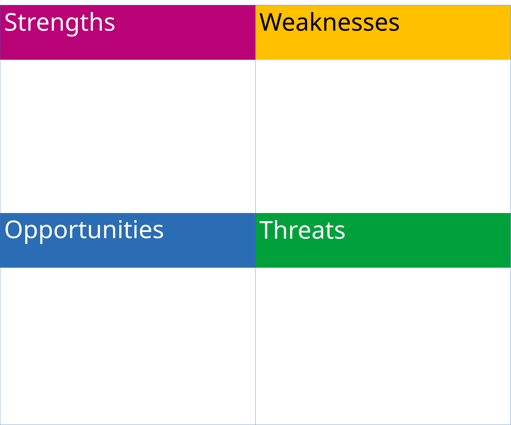
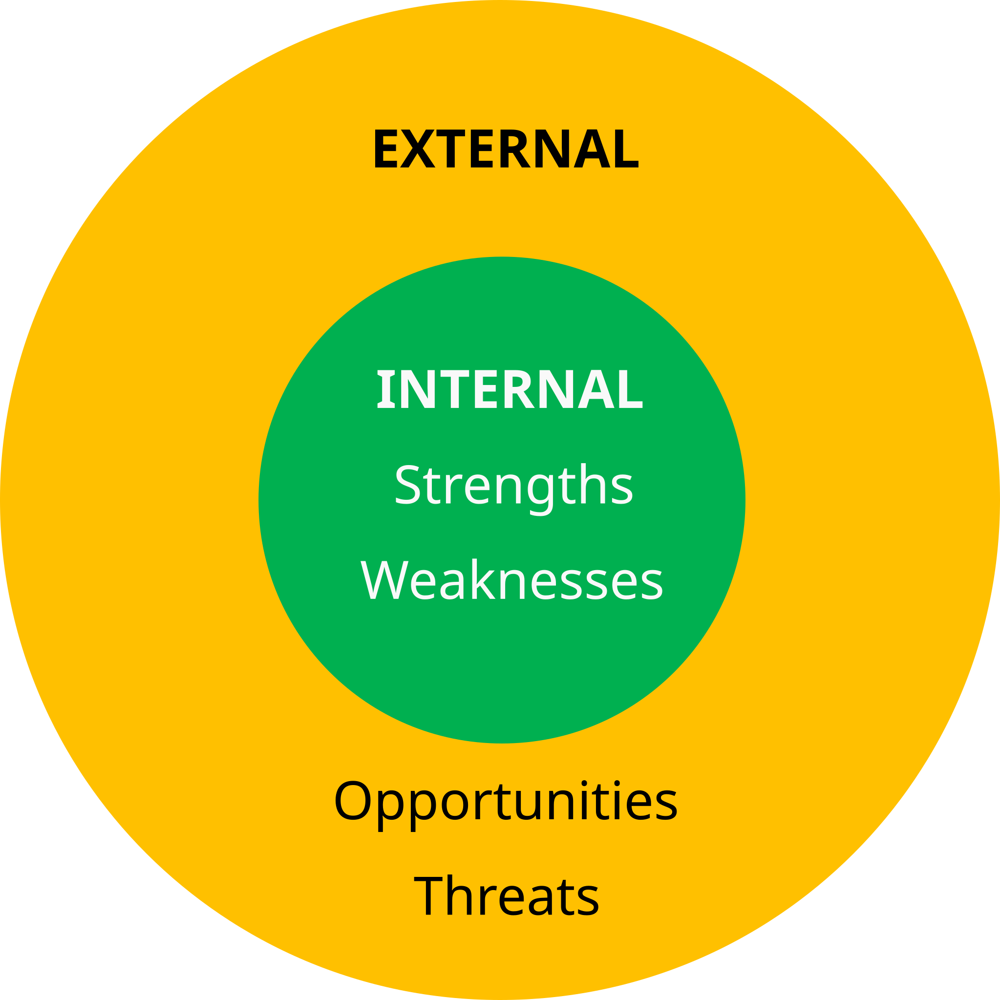

El análisis FODA (en inglés, SWOT) identifica las fortalezas, oportunidades, debilidades y amenazas pertinentes de una política, un tema o un acontecimiento. Las fortalezas y las debilidades son factores internos que dan una visión realista de las capacidades actuales. Las oportunidades y las amenazas son factores externos a los que hay que responder.

### Úsela para…

- Identificar prioridades para las áreas de política o de estrategia.
- Identificar retos que pueden surgir en el futuro a más largo plazo y oportunidades que pueden abrirse para usted.
- Abrir la reflexión de las personas sobre cómo tender un puente entre el futuro a más largo plazo y el hoy: qué podría necesitarse para mitigar los riesgos y adaptarse a ellos, y dónde pueden encontrarse oportunidades.
- Obtener una visión más clara de las incertidumbres actuales, que pueden alimentar un ejercicio de [Escenarios](escenarios.qmd) o ayudar a construir un plan estratégico.

### Obtendrá…

- Un conjunto de fortalezas y debilidades de su organización en relación con la ejecución de la política o estrategia.
- Un conjunto de amenazas y oportunidades externas relacionadas con la política o estrategia.

### Tenga cuidado con…

- Concentrarse demasiado en un área en detrimento de las demás, por lo general en las amenazas.
- Que las personas confíen demasiado en las fortalezas.

### A quién involucrar

Es sobre todo una herramienta para talleres o discusiones de grupo, pero también puede hacerse simplemente como investigación documental que se hace circular para recibir comentarios. Involucre tanto a quienes conocen las capacidades internas como a quienes conocen el entorno externo. Es valioso involucrar a quienes participan en el desarrollo de la política o estrategia.

### Número de participantes

Hasta 12. Puede involucrar a más personas y dividirlas en subgrupos, pero probablemente verá que no es necesario.

### Tiempo que toma

2 horas para el ejercicio, más algo de tiempo de preparación y de lectura previa.

### Cómo incluir más perspectivas

- Realice varias sesiones con grupos distintos.
- Comparta con otros grupos pertinentes, como los de áreas de política relacionadas, y recoja sus aportes.
- Combínelo con [Delphi](delphi.qmd) o con entrevistas para recoger más opiniones.

### El enfoque

El análisis FODA es una técnica práctica para trazar un mapa de los temas que influyen en la ejecución exitosa de una política o estrategia. Se trata de llenar la matriz FODA con temas e ideas pertinentes, para poder reunirlos y construir un plan realista.

**Hay cuatro pasos:**

Paso 1. Sesión informativa previa al taller.

Paso 2. Taller: factores internos.

Paso 3. Taller: factores externos.

Paso 4. Identificar las interrelaciones.

### Paso 1: Sesión informativa previa al taller

Asegúrese de que quienes asistan al taller conozcan los informes de cualquier trabajo previo de [Siete preguntas](siete-preguntas.qmd) y de [Escaneo del horizonte](escaneo-horizonte.qmd), y de que hayan reflexionado sobre el entorno en el que trabajan.

### Paso 2: Factores internos

Vuelva a la pregunta de alcance: es en su contexto que se considera cada factor.

En un taller, haga una lluvia de ideas sobre las fortalezas y debilidades de las políticas o estrategias en cuestión. Debería intentar ir más allá de caracterizar unas simplemente como lo opuesto de las otras. Puede necesitar varias tablas FODA si está considerando un abanico de opciones de política.

**Pida al grupo que considere todos los recursos disponibles para ejecutar la política o estrategia, entre ellos:**

- Personas: disponibilidad, habilidades y conocimientos, apertura al cambio, limitaciones clave.
- Presupuesto disponible (y sus límites).
- Situación tecnológica.
- Aspectos geográficos.

**Tiempo estimado para completar este ejercicio: 30 minutos.**

**Explore también**

- El contexto legal.
- Los socios y sus metas u objetivos.
- La solidez de las relaciones: ¿puede trabajar con otras personas?

Es importante hacer evaluaciones realistas en lugar de excesivamente optimistas. Puede notar que a las personas les incomoda admitir debilidades, así que quizás tenga que animarlas o desafiarlas a hacerlo.

### Paso 3: Factores externos

(Tiempo estimado para completar este ejercicio: 30 minutos).

Las oportunidades y las amenazas son cambios externos que habrá notado en su [Escaneo del horizonte](escaneo-horizonte.qmd). En esta etapa no debería limitarlas a las que cree que puede manejar.

**Observe cómo podrían surgir oportunidades y amenazas, por ejemplo, de:**

- Una situación económica cambiante.
- Nuevas tecnologías.
- Cambios demográficos y en las actitudes sociales.
- Cambios ambientales.
- El entorno político (por ejemplo, cambios en la disponibilidad de recursos).

Debería evitar concentrarse demasiado en las amenazas: asegúrese de dedicar también suficiente tiempo a las oportunidades.

### Paso 4: Identifique las interrelaciones

(Tiempo estimado para completar este ejercicio: 30 minutos).

**Busque**:

- Fortalezas que pueden ayudarle a aprovechar oportunidades.
- Fortalezas que puede usar para mitigar amenazas.
- Debilidades que pueden limitar las oportunidades a su alcance.
- Debilidades que hacen las amenazas aún más difíciles, o exclusivas para usted.

### Siguientes pasos

Esto puede formar luego el núcleo de un posible plan estratégico o, alternativamente, alimentar un ejercicio de [escenarios](escenarios.qmd).

### Estudio de caso

Un departamento universitario usó el análisis FODA para identificar estrategias de mejora. El producto incluyó:

| Fortalezas | Debilidades |
|----|----|
| Reputación de la facultad por ser ágil y estar centrada en el cliente | Reputación percibida de la universidad |
| Respaldo del portafolio de \[materia\] en la actividad de investigación | Estructura de personal necesaria para ofrecer un portafolio amplio |
| **Oportunidades** | **Amenazas** |
| Los cambios de política pueden ofrecer oportunidades para ampliar la oferta | Los cambios de política pueden hacer que la oferta pase a los competidores |
| Expansión del mercado | Recortes del gasto público que reducen los recursos disponibles para el desarrollo profesional continuo (CPD) |

**Enfoque alternativo: haga primero los factores externos y evalúe los internos en ese contexto.**

### ¿Necesita ahorrar tiempo?

Puede hacerlo una sola persona como un ejercicio documental, sin el taller, pero probablemente obtendrá menos ideas creativas.

Podría empezar el FODA sin haber hecho el trabajo de [Siete preguntas](siete-preguntas.qmd) o de [Escaneo del horizonte](escaneo-horizonte.qmd), pero corre el riesgo de pasar por alto cambios emergentes clave.

**Los recursos para esta herramienta están en el [Banco de recursos](https://www.gov.uk/government/publications/futures-toolkit-resources-for-government-officials). Los estudios de caso están en el [Banco de estudios de caso](https://www.gov.uk/government/publications/futures-tools-and-methods-case-studies).**
