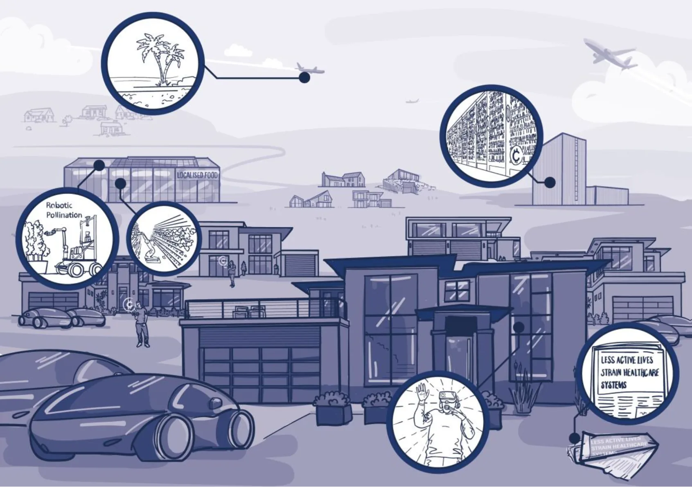
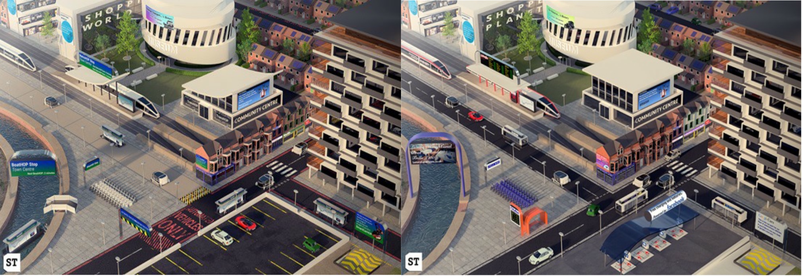

Los futuros experienciales son métodos y herramientas con los que las personas viven una experiencia visceral de un abanico de futuros. Pueden ser valiosos como forma de iniciar una discusión creativa y productiva sobre distintos futuros posibles, como los escenarios o las visiones que haya construido con otras herramientas de esta caja.

Hay muchas formas distintas de desarrollar técnicas experienciales en el trabajo de futuros. El método que use dependerá de factores como su público, el tiempo disponible y el presupuesto. Hay técnicas sencillas que puede probar por su cuenta a bajo costo, y enfoques más elaborados para los que quizás quiera trabajar con especialistas en futuros o con socios de perfil creativo, como artistas o escritores. A continuación damos algunos ejemplos de enfoques que puede adaptar para su proyecto.

### Narrativa y relatos

Las técnicas de narrativa y de relatos pueden ayudar a las personas a imaginar y explorar un escenario futuro posible, o a expresar sus esperanzas y temores sobre el futuro.

#### Titulares de prensa

Podría ofrecer titulares de prensa de un futuro imaginado para provocar una reacción en las personas con las que quiere trabajar, o generarlos con los participantes como parte de un ejercicio de futuros más amplio. Es una forma de pasar de las descripciones de sus escenarios a una visión más desarrollada e intuitiva de cómo es un futuro.

Podría empezar pensando qué tipo de titulares podría ver en los medios. Para cada futuro, pida a los participantes que elaboren al menos cuatro titulares. Puede darles contexto nombrando periódicos nacionales o plataformas de redes sociales conocidos. Puede hacer este ejercicio con bastante rapidez, asignando 5 minutos por futuro, para estimular la creatividad.

En un futuro en el que el poder y la riqueza están distribuidos de forma bastante equitativa, pero el cambio climático es incontrolable, podría encontrar los siguientes titulares:

- Nuestro mundo es un comunismo automatizado de lujo.
- Huracanes: Alexander, Brenda, Charles y Davina causan muertes y daños materiales en la costa este, todo en una sola semana.
- El Consejo de Refugiados, en reunión de emergencia.
- El Tribunal Social Internacional juzgará a los últimos multimillonarios por eludir sus contribuciones sociales.
- La cuota ciudadana de este año: las diez cosas que debe saber.

#### Un día en la vida de

Considere cómo sería "un día en la vida de" alguien como usted en cada futuro. Piense en las cosas rutinarias y cotidianas que podría estar haciendo. ¿En qué sería diferente la vida de la de hoy? Por ejemplo, en cuanto a su trabajo, su movilidad, la educación, el ocio, las compras, qué y dónde come, su rutina diaria, con quién se relaciona, la economía en general, la política y la regulación.

#### Personas (*personas*)

Las personas (*personas*) son personajes ficticios creados para representar a las distintas personas que podrían usar una política o un servicio, o verse afectadas por ellos. Pueden ser útiles en el trabajo de futuros para explorar cómo podrían vivir sus escenarios personas distintas. El proyecto de [prospectiva *Wireless 2030*](https://www.gov.uk/government/publications/wireless-2030) usó personas de esta manera.

El futurista [Museum of Discovery de Australia](https://mod.org.au/) creó personas en video de siete hermanos que viven en 2050 en el sur de Australia, para involucrar a los jóvenes en la toma de decisiones sobre el futuro.

La [caja de herramientas de formulación abierta de políticas del Policy Lab](https://www.gov.uk/guidance/open-policy-making-toolkit) tiene consejos y recursos para crear personas.

#### Relatos

Si tiene más tiempo, podría usar técnicas de relato para dar vida a un conjunto de escenarios. Compartirlos en talleres podría ayudarle a comprender las reacciones de las personas ante un abanico de futuros posibles. Por ejemplo, [este informe](https://www.foodsecurity.ac.uk/activities/future-food-system-scenarios/) sobre el papel del sistema alimentario del Reino Unido en el cumplimiento de los acuerdos globales incluye versiones escritas y animadas de relatos que se escribieron para ilustrar un conjunto de escenarios.

La Oficina del Comisionado para las Generaciones Futuras de Gales y Public Health Wales usaron [técnicas de relato](https://www.futuregenerations.wales/resources_posts/communities-and-climate-change-in-a-future-wales/), como cartas y postales al futuro, para entender los puntos de vista y las experiencias de personas de comunidades desfavorecidas frente a los efectos futuros del cambio climático.

El relato puede ser una técnica poderosa y, para ser constructivo, debe abarcar tanto las oportunidades como las amenazas del futuro.

#### Ficción especulativa

Es ficción escrita sobre futuros posibles, tanto utópicos como distópicos. Puede usarla para cuestionar su forma de pensar sobre un futuro. La ciencia ficción suele entrar en esta categoría, y hay muchos otros libros y cuentos para elegir; por ejemplo, *El Ministerio del Futuro*, de Kim Stanley Robinson, y *Neuromante* o *Periférico*, de William Gibson.

Exíjase pensar cómo podría ser vivir en uno de estos futuros. ¿Qué le gusta de este futuro? ¿Qué no le gusta? ¿Qué señales tempranas ve de que podríamos dirigirnos en esa dirección?

Podría realizar un taller en el que los participantes escriban su propia ficción especulativa (por ejemplo, con [este método descrito por Fast Company](https://www.fastcompany.com/90783469/sci-fi-prototyping-how-to-predict-the-future-and-prepare-for-the-unexpected)), o buscar ejemplos en línea, como:

- [*Stories from Tomorrow: exploring new technology* \[through useful fiction\]](https://www.gov.uk/government/publications/stories-from-the-future-exploring-new-technology-through-useful-fiction)
- [*RAF Stories from the Future*](https://www.raf.mod.uk/news/articles/third-edition-of-stories-from-the-future/)
- [*One day in 2050*](https://www.oneday2050.org/participants)

#### Artefactos

Use objetos físicos "del futuro" para dar vida a un escenario futuro posible y ayudar a las personas a involucrarse con cómo podría ser. Pueden ser muy sencillos o de producción más profesional, según sus recursos. Entre los ejemplos de esta última están el [Museum of Extraordinary Objects de la Royal Society](https://royalsociety.org/blog/2017/11/the-making-of-the-museum-of-extraordinary-objects/) y los [artefactos del futuro de la alimentación del Institute for the Future](https://legacy.iftf.org/foodinnovationartifacts/). Algunas opciones de menor costo son:

La [caja de herramientas *Futures Bazaar*](https://www.bbc.co.uk/gel/features/futures-bazaar-toolkit) de la BBC ofrece materiales para realizar un taller en el que los participantes crean "artefactos del futuro" con materiales de desecho.

[*The Thing from the Future*](https://situationlab.org/project/the-thing-from-the-future/) es un juego de cartas inmersivo desarrollado por The Situation Lab para iniciar una conversación estratégica y una narrativa en torno a artefactos del futuro. Se empieza describiendo un artefacto del futuro, que se usa para desarrollar cómo podría ser ese futuro.

### Imágenes y diseño especulativo

Usar imágenes ayuda a las personas a entrar rápidamente en la mentalidad de un futuro nuevo, como punto de partida para conversar sobre cómo sería vivir en él. Para hacer más experiencial una herramienta existente, como los [Escenarios](escenarios.qmd), podría contratar a un ilustrador para ilustrar los escenarios o las tendencias emergentes. Los generadores de imágenes con inteligencia artificial pueden crear rápidamente imágenes potentes para estimular la discusión sobre la marcha.

Se usó el diseño especulativo en talleres con personas mayores de todo el país, como parte del proyecto de prospectiva de GO-Science sobre el [futuro de una población que envejece](https://www.gov.uk/government/publications/future-of-an-ageing-population), para comprender sus respuestas a los distintos futuros posibles representados.

### Videos y realidad virtual

Usar videos y películas es otra forma de ayudar a las personas a explorar un futuro posible. Hay muchas películas de ciencia ficción para elegir, tanto negativas como (menos) positivas. Algunas son más plausibles que otras. También puede buscar en internet fragmentos de películas o anuncios de distintas empresas sobre cómo imaginan sus productos en el futuro.

Como con la narrativa, es un punto de partida para convocar una conversación sobre futuros posibles distintos del hoy. Explore los supuestos que se hicieron para crear ese futuro. Explore cómo se construye el mundo futuro.

El [Museum of the Future](https://www.youtube.com/watch?v=qpyxwnHAP3I) del Dstl (laboratorio de ciencia y tecnología de defensa del Reino Unido) usa un entorno de realidad virtual para que las personas vean un futuro posible e interactúen directamente con cosas que hoy no existen.

### Gamificación

El juego consiste en lograr que los participantes usen información para tomar decisiones sobre el futuro en un entorno controlado y sin riesgos. Puede usarse para desarrollar perspectivas alternativas del futuro, o para poner a prueba las fortalezas y debilidades de una política o estrategia frente a una visión o a un conjunto de escenarios futuros. Hay varios juegos de mesa que podría probar, como las [*Cards for the Future*](https://www.nesta.org.uk/report/cards-for-the-future/) de Nesta, que invitan a los jugadores a pensar en visiones positivas de la tecnología y la sociedad. Los [juegos de guerra](https://www.gov.uk/government/publications/defence-wargaming-handbook) (*wargaming*) son una técnica avanzada, muy usada en defensa. El juego de roles invita a los participantes del taller a asumir el papel de distintos grupos de actores en escenarios futuros, para ayudarles a entender cómo podrían responder esos grupos o qué retos enfrentan. La técnica es especialmente eficaz si los participantes asumen roles distintos de su experiencia real o de sus responsabilidades actuales (por ejemplo, si el personal del Gobierno hace el papel de las empresas y las empresas el del tercer sector).

Estos cinco pasos describen una forma sencilla de usar el juego de roles en su trabajo de futuros:

1. Presente un escenario existente a los participantes.
2. Asigne roles a grupos o individuos. Asigne objetivos generales a cada rol (si lo desea).
3. Cada grupo revisa las fortalezas y debilidades del escenario desde la perspectiva de su grupo de actores.
4. Luego, cada grupo identifica cómo responderá su grupo de actores al escenario (tomando decisiones estratégicas pertinentes para los objetivos del área de política).
5. Formule recomendaciones de política a partir de la conversación.

Repita con otros escenarios según sea necesario.
