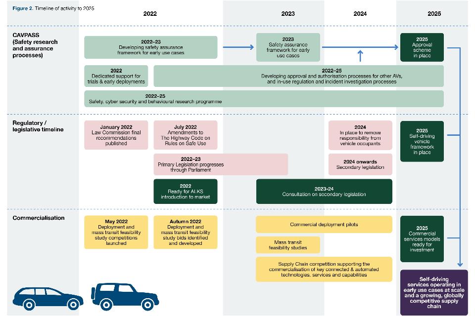

Las hojas de ruta (*roadmaps*) son representaciones estructuradas de las etapas que conducen a su meta estratégica o a su futuro preferido.

### Úsela para…

- Construir una comprensión común y explorar opciones estratégicas o de política. Más adelante, puede usarla para apoyar la ejecución y la gestión de la implementación estratégica.
- Construir una imagen integral de los distintos elementos pertinentes para su meta y de cómo se combinan con el tiempo.
- Profundizar la comprensión de las personas sobre las conexiones y relaciones complejas entre los distintos elementos.
- Apoyar la comunicación y la cooperación, desarrollando una comprensión compartida y una alineación entre redes y equipos.

### Obtendrá…

- Un conjunto claro y estructurado de los pasos necesarios para alcanzar su meta.

### Tenga cuidado con…

- La hoja de ruta es una guía estratégica. Puede usarse para crear un plan de acción más detallado.
- No contar en la sala con las habilidades y el conocimiento necesarios.
- El principal reto de facilitación será sacar a la luz las dependencias clave entre los elementos de la hoja de ruta.

### A quién involucrar

La hoja de ruta se desarrolla mejor en equipo, en un taller, sumando a actores clave y a expertos en la materia si es posible. Asegúrese de tener representantes de todas las áreas afectadas. Si es posible, incluya a personas responsables de desarrollar e implementar la estrategia y a tomadores de decisiones de alto nivel.

### Número de participantes

Por lo general, de 4 a 20 para un taller; divídalas en subgrupos si es necesario. Necesitará un facilitador por subgrupo. Puede involucrar a más personas fuera del taller pidiéndoles que revisen su hoja de ruta o le añadan detalle.

### Tiempo que toma

Construir una hoja de ruta es un proceso iterativo y flexible, así que el tiempo necesario varía. Como mínimo necesitará medio día para un taller, más tiempo de preparación y de revisión. Tomará al menos un día si tiene subgrupos. Puede tomar más si quiere hacer investigación adicional en el paso 3.

### Cómo incluir más perspectivas

- Comparta las hojas de ruta con otros grupos y recoja sus aportes.
- Revise de nuevo las hojas de ruta con grupos más diversos para actualizarlas.

### El enfoque

Una de las virtudes poderosas de la hoja de ruta es que puede usarse para decidir cómo lograr cualquier objetivo, ya sea nacional y estratégico o algo que quiera lograr personalmente en el futuro.

La hoja de ruta se usa una vez que conoce sus objetivos estratégicos: a dónde quiere llegar en el futuro a más largo plazo. Lo habrá determinado con su trabajo previo en la ruta.

Un aspecto especialmente útil de la hoja de ruta es que combina desarrollos conocidos (ciertos) con desarrollos especulativos (inciertos). La hoja de ruta no tiene que ser una sola línea ni limitarse al tema central; puede ampliarse para incluir desarrollos en áreas de política relacionadas que puedan afectar la pregunta central del proyecto.

#### Hay cuatro pasos:

#### Paso 1

Acordar el alcance.

#### Paso 2

Crear un primer borrador de la hoja de ruta.

#### Paso 3

Afinar y desarrollar las líneas de tiempo de las hojas de ruta.

#### Paso 4

Presentar sus hojas de ruta.

### Paso 1: Acuerde el alcance

Recuerde a las personas la meta estratégica o el futuro preferido.

Podría usar la herramienta [FODA](foda.qmd) o una técnica [experiencial](futuros-experienciales.qmd) para ayudar a las personas a involucrarse con la meta.

### Paso 2: Cree un primer borrador de la hoja de ruta

Es un ejercicio de mucha energía en el que se generan ideas, que se evaluarán en el paso siguiente.

Partiendo de donde está hoy, piense en acciones intermedias específicas y ubicadas en el tiempo que tienen que ocurrir para llegar a su punto final. Añada cualquier acontecimiento e impulsor externo pertinente que pueda dar forma al área de política en consideración.

### Paso 3: Afine y desarrolle las líneas de tiempo de las hojas de ruta

Es el momento de la discusión y del cuestionamiento. Su objetivo es hacer la hoja de ruta lo más resiliente posible.

Puede querer hacer todo esto en un taller, pero si el tiempo lo permite puede ser valioso llevarse algunos elementos para investigarlos más o para recibir aportes de personas con conocimientos particulares.

Puede ser útil usar un marco para clasificar los factores identificados en el paso anterior; por ejemplo, según los distintos actores responsables o según las palancas de política.

Considere qué necesita "completarse" más. ¿Qué falta? ¿Qué necesita más información? ¿Sigue teniendo sentido?

Piense también en cómo interactúan los distintos pasos. ¿Dónde están las dependencias? Indíquelas en su tablero con flechas.

Algunos pasos intermedios pueden necesitar su propia hoja de ruta individual. Piense en incluir en su hoja de ruta el cuándo, el porqué, el qué y el quién.

### Paso 4: Presente sus hojas de ruta

Una representación visual de la hoja de ruta, que muestre los desarrollos principales en distintos momentos, puede ser una forma muy eficaz de presentarla a otras personas. Con frecuencia, cuanto más creativa es la presentación, más ampliamente se entiende.

Al final de esta página hay un ejemplo del plan del Gobierno [*Connected & Automated Mobility 2025: Realising the benefits of self-driving vehicles in the UK*](https://assets.publishing.service.gov.uk/government/uploads/system/uploads/attachment_data/file/1099173/cam-2025-realising-benefits-self-driving-vehicles.pdf) (movilidad conectada y automatizada 2025).

### Siguientes pasos

Las hojas de ruta son estratégicas. Puede usarlas para defender un curso de acción. Puede convertirlas en planes tácticos y operativos.

Piense en cómo seguirá el avance hacia la meta, si hay puntos clave en los que podría querer repetir este ejercicio y si hay personas o grupos particulares que podrían revisar la hoja de ruta para validarla.

### Enfoques alternativos

Para una técnica de hojas de ruta más avanzada, podría usar el enfoque y las plantillas creados por [IfM Engage](https://engage.ifm.eng.cam.ac.uk/roadmapping/) (Universidad de Cambridge).

### Estudio de caso

La línea de tiempo de la hoja de ruta, publicada en agosto de 2022 en el [documento de mando *Connected and Automated Mobility 2025*](https://www.gov.uk/government/publications/connected-and-automated-mobility-2025-realising-the-benefits-of-self-driving-vehicles), expuso cómo pretendía trabajar el Gobierno para materializar los beneficios de las tecnologías de movilidad conectada y automatizada (CAM) durante los tres años siguientes a su publicación. La actividad se divide en tres categorías: el programa CAVPASS (*Connected and Automated Vehicles: Process for Assuring Safety and Security*, proceso para garantizar la seguridad física y cibernética de los vehículos conectados y automatizados); la regulatoria y legislativa; y la comercialización. Muestra la actividad real y planificada del Gobierno entre 2022 y 2025, que era exacta en el momento de la publicación.

**Los recursos para esta herramienta están en el [Banco de recursos](https://www.gov.uk/government/publications/futures-toolkit-resources-for-government-officials). Los estudios de caso están en el [Banco de estudios de caso](https://www.gov.uk/government/publications/futures-tools-and-methods-case-studies).**

Nota: las siguientes 27 frases son una explicación detallada del diagrama anterior.

Línea de tiempo de la actividad hasta 2025. La línea de tiempo abarca de 2022 a 2025 y se divide en tres temas.

Primer tema: CAVPASS (investigación en seguridad y procesos de garantía).

2022: apoyo dedicado a pruebas y despliegues tempranos, que alimenta lo siguiente.

2023: marco de garantía de la seguridad para los primeros casos de uso, que alimenta lo siguiente.

2025: régimen de aprobación en funcionamiento.

2022-2023: desarrollo del marco de garantía de la seguridad para los primeros casos de uso.

2022-2025: programa de investigación en seguridad, ciberseguridad y comportamiento.

Finales de 2022-2025: desarrollo de los procesos de aprobación y autorización para otros vehículos autónomos, y de los procesos de regulación en uso y de investigación de incidentes.

Segundo tema: línea de tiempo regulatoria y legislativa.

Enero de 2022: publicación de las recomendaciones finales de la Law Commission (comisión jurídica).

Julio de 2022: modificaciones al Código de Circulación (*Highway Code*) sobre las normas de uso seguro.

2022-2023: la legislación primaria avanza en el Parlamento.

2022: preparación para la introducción en el mercado de los sistemas automatizados de mantenimiento de carril (ALKS).

2023-2024: consulta sobre la legislación secundaria.

2024: medidas en vigor para eximir de responsabilidad a los ocupantes del vehículo.

2024 en adelante: legislación secundaria.

2025: marco para los vehículos autónomos en funcionamiento.

Tercer tema: comercialización.

Mayo de 2022: lanzamiento de los concursos de estudios de viabilidad de despliegue y de transporte masivo.

Otoño de 2022: identificación y desarrollo de las propuestas de estudios de viabilidad de despliegue y de transporte masivo.

2023: estudios de viabilidad de transporte masivo.

2023-2024: pilotos de despliegue comercial.

2023-2024: concurso de cadena de suministro que apoya la comercialización de tecnologías, servicios y capacidades clave de movilidad conectada y automatizada.

2025: modelos de servicios comerciales listos para la inversión.

Los tres temas confluyen en un punto general: servicios de conducción autónoma que operan en los primeros casos de uso a escala, y una cadena de suministro en crecimiento y competitiva a nivel mundial.
