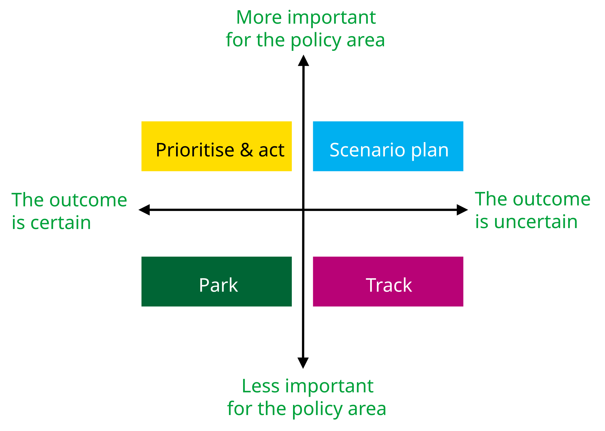

El mapeo de impulsores toma las fuerzas de cambio que recogió en el [Escaneo del horizonte](escaneo-horizonte.qmd) y las ordena según una clasificación como PESTLE, para asegurarse de haber captado impulsores en las áreas pertinentes. Luego ubica lo encontrado en un mapa para ver cuáles son los más importantes de abordar.

### Úsela para…

- Asegurarse de no haber pasado por alto impulsores de cambio importantes.
- Ver qué impulsores serán los más importantes para la pregunta de alcance.
- Explorar qué impulsores son más o menos ciertos.
- Desarrollar el insumo clave para los "ejes de incertidumbre", que usará para construir un conjunto de escenarios futuros.

### Obtendrá…

- Una lista de impulsores dividida en categorías.
- Una lista de impulsores que deben priorizarse, atenderse y seguirse.
- Una lista de impulsores que son importantes para su área de política, pero cuyo desenlace es muy incierto y que podrían alimentar un ejercicio de escenarios.

### Tenga cuidado con…

Puede que su grupo de participantes no haya estado expuesto a un abanico suficientemente amplio de impulsores. Puede mitigarlo recurriendo a expertos externos o partiendo de una lista de impulsores investigada previamente, o ambas cosas.

### A quién involucrar

- Personas con interés en el área de política.
- Obtendrá los mejores resultados con un grupo diverso de participantes.
- Puede considerar incluir expertos externos o actores externos, o ambos, para aportar percepciones más ricas y cuestionar los supuestos.

### Número de participantes

Desde un mínimo de 6 hasta un grupo más grande.

### Tiempo que toma

El taller dura unas dos horas (prevea un poco más si es virtual o híbrido).

### Cómo incluir más perspectivas

- Amplíe su grupo de participantes para incluir a personas de fuera de su área de política.
- Consulte antes, mediante una encuesta, a personas de fuera de su área y añada sus ideas a su lista investigada previamente.
- Realice varias sesiones con grupos distintos.

### El enfoque

**Hay tres pasos:**

Paso 1. Presentar el taller y el enfoque PESTLE.

Paso 2. Lluvia de ideas para listar impulsores.

Paso 3. Mapear los impulsores.

**Tiempo estimado para completar este ejercicio: 15 minutos.**

### Paso 1: Introducción y enfoque PESTLE

Presente o recapitule los objetivos del proyecto. Explique cómo encaja este taller en el proceso de futuros más amplio, si lo hay.

Se usan distintas siglas para clasificar los impulsores (PESTLE, STEEP, STEEPV), y todas son versiones del mismo enfoque.

PESTLE, por ejemplo, contiene seis categorías de impulsores: políticos, económicos, sociales, tecnológicos, legales y regulatorios, y ambientales.

STEEPV excluye los legales, pero incluye los valores.

Puede que su organización prefiera alguna.

**Tiempo estimado para completar este ejercicio: 45 a 60 minutos.**

### Paso 2: Lluvia de ideas de impulsores

- Pida a los participantes que identifiquen qué está impulsando el cambio, animándolos a pensar en el contexto global. Podría pedirles que se concentren cada uno en una o dos categorías PESTLE.
- Use frases cortas y descriptivas para que los impulsores queden muy claros. Incluya la naturaleza del cambio, como "creciente" o "estable" (por ejemplo, "Crecimiento económico sostenido en China" es más claro que "La economía"). Estimule a que se encuentren tantos impulsores como sea posible. Si es útil, puede dividirlos en impulsores que actúan en el corto, el mediano y el largo plazo.

**Tiempo estimado para completar este ejercicio: 50 a 60 minutos.**

### Paso 3: Mapee los impulsores

Ubique los impulsores en una matriz de importancia frente a certeza:

- Agrupe los impulsores relacionados a medida que los ubica en los cuadrantes.
- Concentrándose en los cuadrantes superior izquierdo (más importante y más cierto) y superior derecho (más importante y más incierto), identifique de 3 a 5 impulsores que sean los más importantes para el área de política.
- Si ha trabajado en más de un grupo, compare los mapas de impulsores. Discuta las diferencias y cualquier idea adicional que surja.
- Cada cuadrante tiene implicaciones distintas para los impulsores que contiene y le ayudará a determinar los siguientes pasos apropiados para cada uno. Por ejemplo:
    - Los impulsores más importantes y más ciertos son los que hay que priorizar y atender ahora.
    - Los más importantes y más inciertos podrían ser objeto de más investigación o usarse en un proceso de escenarios.
    - Los más inciertos y menos importantes podrían seguirse, ya que pueden volverse más significativos con el tiempo.
    - Los más ciertos y menos importantes pueden dejarse de lado con tranquilidad por el momento.

### Siguientes pasos

Dependerán del lugar que ocupe este taller en su proceso de futuros general.

- **Si es la primera parte de un ejercicio de escenarios**, como en la [Ruta 4](rutas.qmd). En este caso, puede concentrarse en el cuadrante superior derecho, donde ubicó los impulsores muy inciertos y estratégicamente importantes para su área de política. Los impulsores de este cuadrante se llaman incertidumbres críticas. Usará estos impulsores como insumo de la primera etapa del ejercicio de [Escenarios](escenarios.qmd), en la que elige sus "ejes de incertidumbre". Estos le ayudan a construir un conjunto de escenarios de futuros distintos para explorar formas alternativas en que podría tener que desarrollarse el área de política.
- **Si es la primera parte de un taller de construcción de visión**, como en la [Ruta 2](rutas.qmd). Aquí, concéntrese en el cuadrante superior izquierdo, donde ubicó los impulsores estratégicamente importantes para su área de política y con un desenlace cierto. Son impulsores que ya deberían estar cambiando el entorno de políticas de formas claras y predecibles. Puede usar la [Construcción de visión](vision.qmd) para describir resultados positivos al abordar estos impulsores.

### ¿Necesita ahorrar tiempo?

Si tiene poco tiempo, puede usar una lista de impulsores existente (por ejemplo, a partir del [Trend Deck](https://www.gov.uk/government/collections/trend-deck-spring-2021), de [Global Strategic Trends](https://www.gov.uk/government/publications/global-strategic-trends) o de otras listas de impulsores en línea). Esto podría ahorrarle unos 30 minutos en el paso 2.

### Estudio de caso

El informe de prospectiva *Net Zero Society* de GO-Science buscaba responder cómo podría cambiar plausiblemente la sociedad hacia 2050 y cuáles podrían ser los impulsores de ese cambio. A partir de un escaneo del horizonte previo que identificó impulsores de posibles cambios sociales futuros, los participantes mapearon esos impulsores según su impacto en las emisiones de gases de efecto invernadero y en el consumo de energía del Reino Unido, y según la incertidumbre sobre la dirección de su desenlace. El mapeo de impulsores ayudó a identificar las incertidumbres críticas (impulsores evaluados como muy importantes y muy inciertos a la vez). Estas incertidumbres críticas se llevaron luego a talleres de construcción de escenarios.

Los recursos para esta herramienta están en el [Banco de recursos](https://www.gov.uk/government/publications/futures-toolkit-resources-for-government-officials).

Los estudios de caso están en el [Banco de estudios de caso](https://www.gov.uk/government/publications/futures-tools-and-methods-case-studies).
