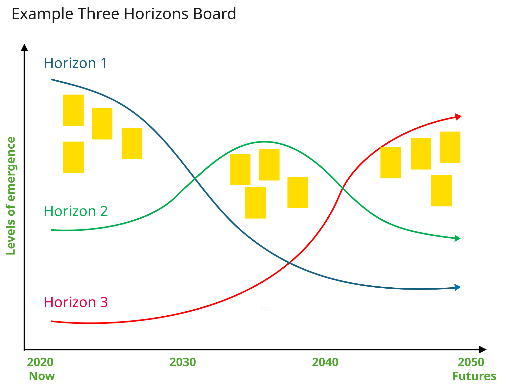

La herramienta de Tres horizontes ofrece un marco para pensar el futuro que reconoce la incertidumbre profunda y la incomodidad que pueden sentir las personas al considerar un futuro desconocido. La herramienta ayuda a enmarcar una conversación constructiva en la que pueden examinarse y vincularse tanto el presente y sus limitaciones como distintos futuros posibles. Permite a las personas construir juntas el puente entre el hoy y un mañana preferido.

### Úsela para…

- Conectar lo que ocurre hoy con futuros posibles y preferibles.
- Estimular la discusión sobre cómo podrían desarrollarse las tendencias.
- Entender cómo podrían surgir distintos temas en los tres horizontes temporales.
- Identificar algunas de las oportunidades y retos que pueden surgir en el futuro a más largo plazo, y entender qué podría necesitarse para mitigar los riesgos y adaptarse a ellos.

### Obtendrá…

- Un diagrama de Tres horizontes completo.

### Tenga cuidado con…

- El principal reto de facilitación es lograr que las personas entiendan que están trabajando con tres horizontes temporales distintos.
- Si no conoce esta herramienta, puede considerar traer a un facilitador con experiencia en su uso.

### A quién involucrar

La herramienta de Tres horizontes funciona mejor con un equipo lo más diverso posible: interdisciplinario, de distintas funciones y de distintos grupos de actores.

### Número de participantes

Necesitará un mínimo de 10 personas para dar riqueza al análisis. Puede dividirlas en subgrupos si es necesario. Necesitará un facilitador por subgrupo.

### Tiempo que toma

Mínimo para el taller: 3,5 horas si es presencial y 4 horas si es virtual o híbrido. También necesitará tiempo para preparar antes y para redactar los hallazgos después.

### Cómo incluir más perspectivas

Comparta el tablero de Tres horizontes con otros grupos y recoja sus aportes.

### El enfoque

La herramienta de Tres horizontes le permite situarse en el presente y proyectar su pensamiento hacia el futuro. Ayuda a enmarcar una conversación constructiva en la que pueden explorarse tanto el presente y sus limitaciones como distintos futuros posibles. Luego, se puede construir en conjunto una forma de tender un puente desde los futuros preferidos hasta hoy.

El marco representa el paso desde los supuestos y el *statu quo* de hoy, que son el primer horizonte, hasta la aparición de nuevos patrones, bolsillos del futuro que ya ocurren hoy, en el tercero, a través de la actividad de transición del segundo. En el tablero (vea abajo) verá que el hoy (Horizonte 1) disminuye con el tiempo. El Horizonte 3 muestra la aparición de nuevos patrones, desde apenas visibles hoy hasta importantes en el futuro. El Horizonte 2 es la fase de transición entre el hoy y el futuro, en la que el mañana se hace más evidente a medida que el hoy se desvanece.

A continuación se describe un enfoque básico de Tres horizontes. Hay una versión más completa del ejercicio en la [caja de herramientas de Public Health Wales y de la Comisión de Generaciones Futuras de Gales](https://www.futuregenerations.wales/resources_posts/three-horizons-toolkit/).

Esa versión incluye refinamientos sobre el Horizonte 2, pero requiere una facilitación con más experiencia.

Hay cuatro pasos:

Paso 1. Horizonte 1.

Paso 2. Horizonte 3.

Paso 3. Horizonte 2.

Paso 4. Redactar los hallazgos.

![Gráfico de tres horizontes con dos ejes. El eje horizontal se rotula "Ahora", "2030", "2040" y "Futuros 2050"; el vertical, "Niveles de emergencia". El "Horizonte 1", una línea azul en forma de S, desciende de emergencia alta a baja. El "Horizonte 2", una línea verde, sube de emergencia media a alta hacia 2035 y vuelve a bajar a emergencia media hacia 2050. El "Horizonte 3", una línea roja en forma de S, sube de emergencia baja a alta. Una nube azul hacia 2025, entre las líneas del Horizonte 1 y del Horizonte 2, dice "Desvaneciéndose"; una nube verde hacia 2035, entre las tres líneas, dice "En transición"; y una nube roja hacia 2045, entre las líneas del Horizonte 2 y del Horizonte 3, dice "Emergiendo".](images/Image_Pg_44.svg)

**Tiempo estimado para completar este ejercicio: 70 a 80 minutos.**

### Paso 1: Horizonte uno

El Horizonte uno explora nuestros supuestos compartidos sobre lo que existe hoy. Algunos seguirán aquí dentro de 30 años y otros no. Es la curva superior, el horizonte de las tendencias que se desvanecen, que empieza en la esquina superior izquierda del diagrama.

- Presente el proyecto y la herramienta de Tres horizontes.
- Pida a las personas que consideren: ¿qué dan por sentado, sabiendo que está ahí y que funciona de una manera particular?
   - Modelos de operación.
   - Cadena de suministro.
   - Políticas.
   - Procesos organizacionales.
   - Actores.
   - Regulaciones.
   - Presupuestos.
   - ¿Qué más?
- Dé un ejemplo. Por ejemplo, un supuesto del Horizonte 1 sobre cómo funcionan las cosas es que hay electricidad las 24 horas, los 7 días de la semana. No todos los países y lugares pueden contar con ello, pero en el Reino Unido sí. ¿Qué otras cosas que existen hoy casi no notamos?
- Complete la línea de tiempo del Horizonte uno (azul en el gráfico anterior). Piense en qué momento el supuesto, la tendencia o la idea en cuestión empezará a perder vigencia y ubíquelo ahí.

**Tiempo estimado para completar este ejercicio: 45 a 60 minutos.**

### Paso 2: Horizonte tres

El Horizonte tres describe el futuro. Lo exploramos a continuación para poder tender el puente (Horizonte dos) entre sus visiones de lo que podría ser el futuro y el hoy. Este horizonte trata de lo que está surgiendo hoy y se volverá común en el futuro. Puede llamarse la mentalidad visionaria o aspiracional.

Puede ayudar a los participantes que haga una breve presentación de tendencias emergentes, señales débiles y factores disruptivos. Un ejercicio de [escaneo del horizonte](escaneo-horizonte.qmd) habrá identificado algunos de ellos.

- En subgrupos, pongan tantas ideas como puedan en la línea de tiempo del Horizonte tres (roja en el gráfico anterior). Ubiquen en la línea de tiempo cuándo creen que se volverán corrientes.
- Pida a las personas que consideren:
   - ¿Cuáles son los temas emergentes y los cambios novedosos que están transformando el mundo en general?
   - ¿Cuáles son los cambios más transformadores que ven surgir?

**Tiempo estimado para completar este ejercicio: 120 a 140 minutos.**

### Paso 3: Horizonte dos

El Horizonte dos vincula el Horizonte tres con el Horizonte uno. En esta parte de la herramienta, explora qué rasgos del Horizonte uno se ven desafiados por un cambio emergente del Horizonte tres. También podría buscar cambios emergentes del Horizonte tres que ofrezcan oportunidades.

- Examine los rasgos del Horizonte uno:
   - ¿Qué rasgos son los más vulnerables?
   - ¿Cuáles tendrá que abandonar?
   - ¿Cuáles se fortalecen y seguirán existiendo a largo plazo?
- Elija un rasgo del Horizonte uno que esté siendo desafiado.
- Emparéjelo con el cambio emergente del Horizonte tres que lo desafía.
- Haga una lluvia de ideas sobre qué puede hacerse para mitigar el reto o adaptarse a él, y agrupe las ideas en la línea de tiempo del Horizonte dos (verde en el gráfico anterior).
- Ubíquelas donde crea que ocurrirá la adaptación.
- Los grupos también pueden elegir un par que ofrezca oportunidades y hacer una lluvia de ideas de nuevos futuros a partir de él.
- Repita el ejercicio con varios rasgos.

### Paso 4: Redacte los hallazgos

Guarde una copia o fotografía en alta resolución del tablero. También es importante recoger la reflexión creativa que surgió en cada horizonte. Puede alimentar la reflexión posterior sobre estrategia y políticas.

### Siguientes pasos

Este ejercicio puede ser una buena antesala de la herramienta de [Escenarios](escenarios.qmd), porque ofrece una comprensión más profunda de las incertidumbres que enfrenta el mundo hoy.

### ¿Necesita ahorrar tiempo?

A los participantes puede resultarles complejo trabajar con Tres horizontes. Puede ayudarles preparando algunas ideas para los horizontes 1 y 3. El Horizonte 1 son los supuestos de hoy, y podría tomarlos de los medios actuales. Para el Horizonte 3, puede tomarlas de catálogos de tendencias (como el [Trend Deck de GO-Science](https://www.gov.uk/government/collections/trend-deck-spring-2021)), del [Escaneo del horizonte](escaneo-horizonte.qmd) y del [Mapeo de impulsores](mapeo-impulsores.qmd). Si los participantes tienen estas ideas por anticipado, la discusión será más rica, y también podría ahorrar algo de tiempo en cada uno de los pasos 1 a 3. Por otro lado, existe el riesgo de restringir la discusión a temas que usted ya había considerado.

### Estudio de caso

Una organización benéfica internacional quería explorar cómo se desarrollarían cuatro áreas temáticas en el futuro. Después de un ejercicio de escaneo del horizonte que identificó muchos desarrollos posibles, realizaron un taller con la técnica de Tres horizontes para explorar futuros posibles. Entre las oportunidades comunes del Horizonte 2 estuvieron la tecnología (localizada, inteligencia artificial, *blockchain*), la educación y la organización social (por ejemplo, la renta básica universal). Los productos ayudaron a replantear su dirección estratégica.

### Referencias

La primera versión publicada del marco apareció en un libro de gestión, *The Alchemy of Growth*, de Baghai, Coley y White (1999). Luego fue adaptada de manera significativa por Bill Sharpe y Anthony Hodgson mientras trabajaban en un proyecto de prospectiva del Gobierno británico. La referencia más reciente es Sharpe, Bill (2020), [*Three Horizons: The Patterning of Hope*, Triarchy Press](https://www.triarchypress.net/three-horizons.html).

Los recursos para esta herramienta están en el [Banco de recursos](https://www.gov.uk/government/publications/futures-toolkit-resources-for-government-officials).

Los estudios de caso están en el [Banco de estudios de caso](https://www.gov.uk/government/publications/futures-tools-and-methods-case-studies).
