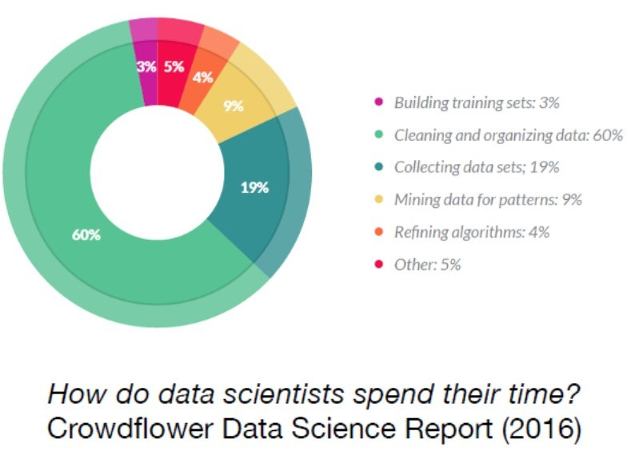
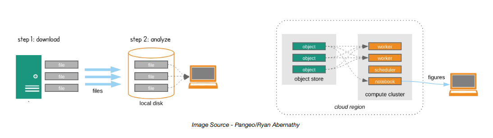
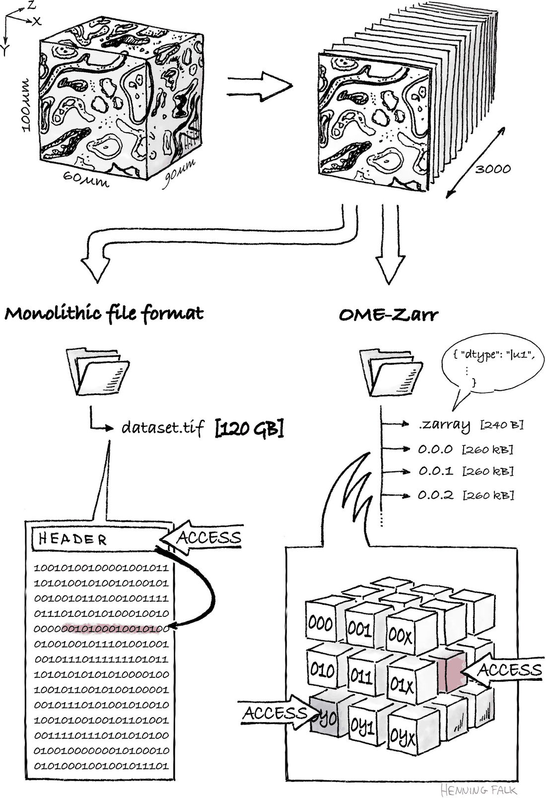
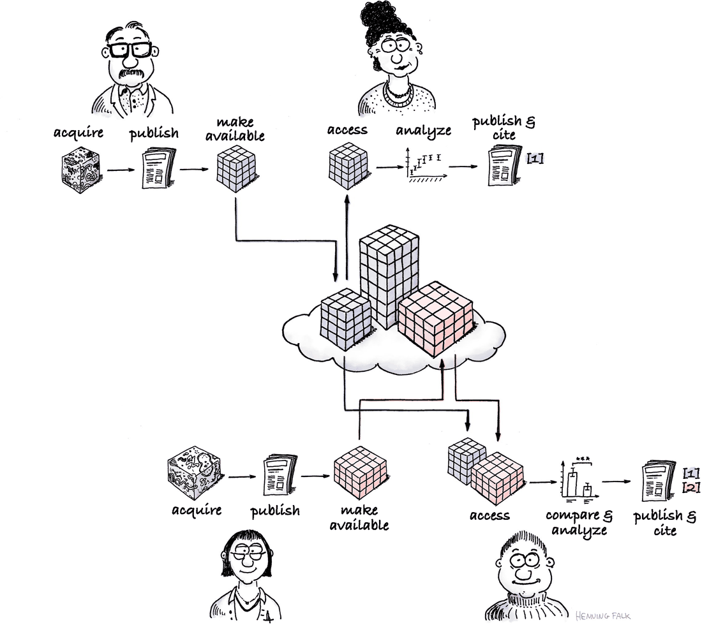

## La idea en una frase {.center}

::: {.r-fit-text}
Que el dato llegue **preparado** para el análisis\
y **organizado** para leer solo la parte que se necesita,\
directamente desde la nube.
:::

## El problema: el modelo de descarga

::: columns
::: {.column width="55%"}
1. Buscar el conjunto de datos
2. Localizar los archivos
3. **Descargarlos** todos
4. **Limpiarlos y organizarlos**
5. Por fin, analizar
:::

::: {.column width="45%"}
::: {.fragment}
- Lento e ineficiente
- Exige almacenamiento
- No escala
- Difícil de compartir
- Mal para el aprendizaje automático
:::
:::
:::

::: {.fragment}
**60–80 %** del tiempo de un científico de datos se va en recolectar y limpiar datos.
:::

## ¿En qué se va el tiempo?

{fig-align="center" height="440"}

<span style="font-size:0.45em;color:#666;">Fuente: CrowdFlower (2016), *Data Science Report*; vía Ladino-Rincón et al., Project Pythia.</span>

## Del modelo de descarga a la nube

{fig-align="center" width="100%"}

- **Antes:** descargar archivos a un disco local y analizarlos allí.
- **Ahora:** el cómputo vive junto al almacenamiento de objetos, en la misma región de la nube.

<span style="font-size:0.45em;color:#666;">Fuente: Pangeo/Ryan Abernathey; vía Ladino-Rincón et al., Project Pythia.</span>

## Los datos crecen exponencialmente

- El archivo de NCAR (desde 1965) crece en escala exponencial.
- ESGF aloja del orden de **20 PB** de simulaciones CMIP6.
- ERA5 en Google Cloud: unos **2 PB** en un solo almacén Zarr.

::: {.callout-tip}
## Caso NCAR
Comparar ERA5 con perfiladores de viento: **una semana → 20 segundos** usando la copia ARCO de ERA5 y Zarr.
:::

# Las dos mitades del término

## Listo para el análisis (*analysis-ready*)

> Datos preprocesados para cumplir los estándares de calidad que exige un análisis determinado.
>
> — Stern et al. (2022)

- Es un concepto **relativo**: depende del usuario y del caso de uso.
- Pasos que se quieren encontrar hechos:
  - formatos comunes, nombres y unidades consistentes
  - valores faltantes bien marcados
  - reinterpolación, alineación de coordenadas
  - miles de archivos unidos en un solo objeto

## Optimizado para la nube {.smaller}

*Cloud-optimized*: formatos que permiten **acceder directamente a subconjuntos** sin recorrer un objeto enorme.

::: columns
::: {.column width="45%"}
**Monolítico** (NetCDF, HDF): un encabezado y un bloque de 120 GB que hay que recorrer o descargar.

**Fragmentado** (Zarr): metadatos pequeños y fragmentos de 260 kB con nombre propio (`0.0.0`, `0.0.1`…).

Se piden **solo** los fragmentos necesarios, **en paralelo**.
:::

::: {.column width="55%"}
{height="400" fig-align="center"}
:::
:::

<span style="font-size:0.45em;color:#666;">Ilustración "Monolithic vs. chunked" de Henning Falk, ©2022 NumFOCUS, CC BY 4.0 (doi:10.5281/zenodo.7037367).</span>

## El patrón común

1. Los metadatos dan **la dirección de cada bloque**.
2. Están en un **formato y un lugar consistentes**.
3. Se cargan **en una sola lectura**.
4. Se leen **subconjuntos** por *chunks* o teselas.

::: {.fragment}
Además: acceso por **HTTP(S)**, lectura **en paralelo**, **carga perezosa** e integración con **xarray y Dask**.
:::

## ARCO = las dos a la vez

> Datos que han recibido el preprocesamiento necesario para una tarea analítica **y** que se almacenan en formatos que permiten un acceso directo y eficiente a subconjuntos.

::: {.fragment}
- Un dato listo para el análisis **no es necesariamente** optimizado para la nube.
- Ya no se mueven datos voluminosos: **se acerca el cómputo a los datos**.
- Se piensa en **conjuntos de datos**, no en archivos.
:::

## ARCO y los principios FAIR {.smaller}

::: columns
::: {.column width="45%"}
- **F**indable: catálogos (STAC, intake)
- **A**ccessible: HTTP y protocolos estándar
- **I**nteroperable: Zarr, xarray, Python, R…
- **R**eusable: metadatos ricos y versiones

::: {.fragment}
**Formatos ARCO por tipo de dato:** Zarr (arreglos), Parquet (tablas), COG (raster), COPC (nubes de puntos).
:::
:::

::: {.column width="55%"}
{height="380" fig-align="center"}
:::
:::

<span style="font-size:0.45em;color:#666;">Ilustración "FAIR re-use" de Henning Falk, ©2022 NumFOCUS, CC BY 4.0 (doi:10.5281/zenodo.7037367).</span>

# Tres caminos hacia ARCO

## Tres paradigmas {.smaller}

| | 1. Imágenes pregeneradas | 2. Formatos nuevos | 3. Referencias virtuales |
|---|---|---|---|
| **Qué** | Pirámides de teselas RGB | Reescribir en Zarr o COG | Índice que apunta a los bytes originales |
| **Copia** | Imágenes, no datos | Sí | No |
| **A favor** | Mapas muy rápidos | Fragmentación a la medida | No reprocesa petabytes |
| **En contra** | Inútil para la ciencia | Duplica almacenamiento | Hereda la fragmentación original |

: {tbl-colwidths="[16,28,28,28]"}

## Paradigma 2: ARCO-ERA5 en Zarr

```python
import xarray as xr

ds = xr.open_zarr(
    "gs://gcp-public-data-arco-era5/ar/full_37-1h-0p25deg-chunk-1.zarr-v3",
    chunks=None,
    storage_options=dict(token="anon"),
)
t2m = ds["2m_temperature"].sel(
    time="2024-01", latitude=slice(13, -5), longitude=slice(281, 293)
)
media = (t2m.mean("time") - 273.15).compute()   # solo baja esos chunks
```

Abrir ~2 PB toma segundos: solo se leen los metadatos.

## Paradigma 3: conjuntos virtuales

::: columns
::: {.column width="50%"}
**El índice del libro** (PO.DAAC)

En lugar de leer el libro completo, se va directo a las páginas que interesan.

El índice pesa de MB a ~100 MB y basta su enlace.
:::

::: {.column width="50%"}
- **Kerchunk**: referencias JSON o Parquet
- **VirtualiZarr**: ensambla archivos en un Zarr virtual
- **Icechunk**: transacciones ACID, versiones, ramas, etiquetas
:::
:::

## Leer un repositorio Icechunk

```python
import icechunk, xarray as xr

URL = "https://data.source.coop/ocean-icechunks/noaa-oisst/oisst.icechunk"
repo = icechunk.Repository.open(icechunk.http_storage(URL))
cred = icechunk.containers_credentials(
    {p: icechunk.s3_anonymous_credentials()
     for p in repo.config.virtual_chunk_containers})
store = repo.reopen(authorize_virtual_chunk_access=cred) \
            .readonly_session("main").store
oisst = xr.open_zarr(store, group="daily", consolidated=False, chunks={})
```

NOAA OISST v2.1 diaria desde 1981, sin descargar archivos.

# La fragmentación lo decide todo

## Mapas frente a series de tiempo

::: columns
::: {.column width="50%"}
**`time: 1`** (un día global por *chunk*)

- Mapa de un día: inmediato
- Serie de 40 años de un punto: más de **14 000** *chunks*
:::

::: {.column width="50%"}
**Muchos años de una región por *chunk***

- Serie de tiempo: inmediata
- Mapa global de un día: **todos** los *chunks*
:::
:::

::: {.fragment}
Algunos proveedores (Copernicus Marine) publican **las dos** fragmentaciones.
:::

## Trampas aprendidas {.smaller}

- El índice virtual **hereda** la fragmentación original (MUR: un archivo por día).
- **NetCDF3** no tiene compresión ni fragmentación interna: no vale la pena virtualizarlo.
- *Chunks* diminutos: ERA5 con Kerchunk necesitaba **~6 GB de RAM** solo para el mapa de referencias.
- Lección: **diseñar pensando en la nube desde el origen**.

# Cómo se producen: Pangeo Forge

## Recetas colaborativas, al estilo conda-forge

- **Receta** (`recipe.py` y `meta.yaml`): extraer → optimizar → almacenar
- **FilePattern**: concatenar (tiempo) o fusionar (variables)
- **Feedstock**: un repositorio por receta, con **trazabilidad** de cada byte
- **Bakery**: clúster en la nube donde se ejecutan las recetas
- Catálogo **STAC** y versiones `MAYOR.MENOR`

::: {.fragment}
Antes: llevar parte de ERA5 a Google Earth Engine tomó **9 meses**.
:::

## La receta `XarrayZarrRecipe`

```{=html}
<div style="display:flex;align-items:center;gap:0.4em;font-size:0.6em;margin:0.6em 0 1em;">
  <div style="flex:1;border:2px solid #2c6fbb;border-radius:8px;padding:0.5em;text-align:center;"><b>1. Caché</b><br>copiar archivos de origen</div>
  <div>➜</div>
  <div style="flex:1;border:2px solid #2c6fbb;border-radius:8px;padding:0.5em;text-align:center;"><b>2. prepare_target</b><br>crear un Zarr vacío</div>
  <div>➜</div>
  <div style="flex:1;border:2px solid #2c6fbb;border-radius:8px;padding:0.5em;text-align:center;"><b>3. store_chunks</b><br>llenar chunks en paralelo</div>
  <div>➜</div>
  <div style="flex:1;border:2px solid #2c6fbb;border-radius:8px;padding:0.5em;text-align:center;"><b>4. Consolidar</b><br>metadatos en un JSON</div>
</div>
```

- NOAA OISST: **14 372 archivos** → un solo Zarr
- Altimetría Copernicus: ~70 GB; media global en **menos de un minuto**
- El cuello de botella fue **descargar desde el origen**, no el cómputo

# ARCO en las instituciones

## NCAR · NOAA · NASA

::: columns
::: {.column width="33%"}
**NCAR (GDEX)**

¿Se puede en Zarr? Sí → convertir.

No → Kerchunk.

Más catálogos intake.
:::

::: {.column width="33%"}
**NOAA**

NODD en AWS, Google y Azure.

National Water Model retrospectivo en Zarr (1979–2023).

CMIP6 en la nube con Pangeo.
:::

::: {.column width="33%"}
**NASA**

VEDA: almacén ARCO + STAC.

PO.DAAC: 12 conjuntos virtuales; **≥10×** más rápido.
:::
:::

## Caso: golfo de Tehuantepec (PO.DAAC)

- Vientos invernales cruzan los pasos de montaña de México.
- Surgencia en mar abierto: el mar se enfría **hasta 10 °C**.
- Cuatro conjuntos virtuales: SST, viento, velocidad vertical, salinidad.
- Décadas de eventos comparadas **sin descargar archivos**.

## Copernicus Marine: ARCO como servicio {.smaller}

::: columns
::: {.column width="50%"}
**Dos representaciones de cada producto**

- **Geo Series**: áreas grandes, periodos cortos (mapas)
- **Time Series**: áreas pequeñas, periodos largos (series)
- El Toolbox **elige automáticamente** según la consulta
:::

::: {.column width="50%"}
**`get` frente a `subset`**

- `get`: archivos originales del productor
- `subset`: representación ARCO armonizada
  - valores faltantes, coordenadas estándar
  - longitudes en [−180, 180)
  - tiempo al **inicio del intervalo**
:::
:::

ARCO es **una convención, no un formato**: la salida puede ser NetCDF, Zarr o CSV.

# Límites y precauciones

## ARCO no es magia {.smaller}

- **Abrir rápido ≠ calcular rápido**: un portátil es un colibrí; para todo el néctar hace falta una bandada.
- **Fuera de la nube** hay límites de peticiones.
- Los conjuntos virtuales **no son datos nuevos**: citar el original.
- Pueden no estar al día y **arrastrar errores** (p. ej., `_FillValue`).
- **Costos** de almacenamiento y salida de datos (*egress*).
- **Sostenibilidad**: personas y financiación, no solo tecnología.

## ¿Por qué importa para el riesgo en Colombia?

- Índices de calor, sequía o estrés térmico marino **por municipio**, sobre 40 años de datos.
- Combinar ERA5, OISST, CMIP6 y modelos hidrológicos **sin descargar**.
- **Cuadernos reproducibles** en Colab: el enlace al dato es el mismo para todos.
- **Versiones exactas** de los datos (Icechunk) para auditar resultados.

::: {.fragment}
Reto: que los datos nacionales también se **publiquen** en ARCO.
:::

## Resumen

- **ARCO** = listo para el análisis **+** optimizado para la nube.
- Tres caminos: imágenes, **formatos nuevos**, **referencias virtuales**.
- La **fragmentación** decide el rendimiento.
- **Pangeo Forge**: recetas abiertas, versionadas y trazables.
- NCAR, NOAA, NASA, Copernicus y Google ya publican datos ARCO.

## Fuentes principales {.smaller}

- Stern et al. (2022). Pangeo Forge. *Frontiers in Climate*. [doi:10.3389/fclim.2021.782909](https://doi.org/10.3389/fclim.2021.782909)
- Abernathey et al. (2021). Cloud-native repositories for big scientific data. *CiSE*. [doi:10.1109/MCSE.2021.3059437](https://doi.org/10.1109/MCSE.2021.3059437)
- Hampapura (2026). ARCO data at GDEX. NCAR. [Video](https://www.youtube.com/watch?v=sX1RU92YUfM)
- Panel NOAA (2022). ARCO for open science. [Video](https://youtu.be/3mDjqIFtS6U)
- Henze y Armstrong (2025). Virtualized data at PO.DAAC. NASA. [Video](https://youtu.be/K1FJyB0-XjY)

- Ladino-Rincón et al. (s. f.). Introducción a ARCO. Project Pythia (AtmosCol 2023). [Cuaderno](https://projectpythia.org/AtmosCol-2023/introduccion-arco/)

Artículo completo: [ARCO](arco.qmd)
