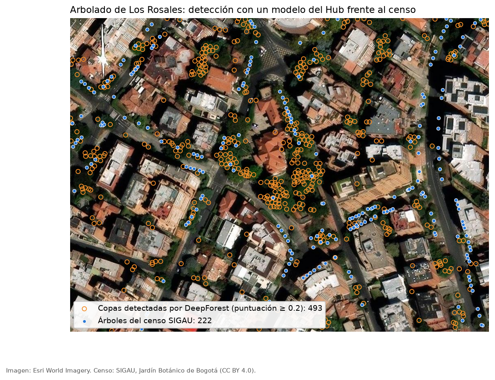
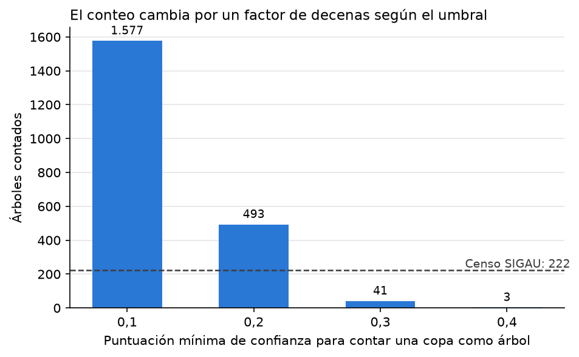

## ¿Qué es Hugging Face?

Hugging Face es una plataforma y comunidad de inteligencia artificial dedicada a la construcción de herramientas de aprendizaje automático de código abierto. A menudo se le describe como el "GitHub del machine learning", ya que permite alojar, compartir y descubrir modelos, conjuntos de datos y aplicaciones creadas por miles de investigadores, empresas y desarrolladores en todo el mundo.

Su ecosistema se organiza principalmente en tres pilares: **Models** (modelos preentrenados listos para usar), **Datasets** (conjuntos de datos para entrenar y evaluar modelos) y **Spaces** (aplicaciones y demos interactivas). A esto se suma su famosa librería `transformers`, que estandarizó el acceso a modelos de última generación en procesamiento de lenguaje natural, visión por computador y audio.

 What is Hugging Face? - Models, Datasets & Spaces

## El Hub: Modelos, Datasets y Spaces

El **Hugging Face Hub** es el repositorio central de la plataforma, con cientos de miles de modelos y decenas de miles de datasets disponibles públicamente. Cada modelo cuenta con una "model card" que documenta su arquitectura, su uso previsto, sus limitaciones y ejemplos de código para implementarlo en pocas líneas.

Los **Spaces** permiten publicar demos interactivas usando frameworks como Gradio o Streamlit, de forma gratuita y sin necesidad de gestionar infraestructura propia, lo que facilita mostrar el funcionamiento de un modelo a cualquier persona directamente desde el navegador.

 Navigating the Model Hub

## La librería Transformers y el pipeline

La librería `transformers` de Hugging Face ofrece una interfaz unificada para descargar y usar miles de modelos preentrenados con muy poco código. Su componente más sencillo es la función `pipeline()`, que encapsula todo el flujo de trabajo (preprocesamiento del texto, inferencia del modelo y posprocesamiento de resultados) en una sola llamada, permitiendo tareas como clasificación de texto, traducción, generación de texto o reconocimiento de entidades en pocas líneas de código.

Por debajo de esta simplicidad, la librería es compatible con los principales frameworks de deep learning (PyTorch, TensorFlow y JAX), lo que da flexibilidad tanto a quienes solo quieren usar un modelo como a quienes desean entrenarlo o ajustarlo (fine-tuning).

 What happens inside the pipeline function? (PyTorch)

## Tokenizers

Antes de que un modelo de lenguaje pueda procesar texto, este debe convertirse en números mediante un **tokenizer**. Hugging Face ofrece la librería `tokenizers`, escrita en Rust para lograr un rendimiento muy alto, que se encarga de dividir el texto en tokens (palabras, subpalabras o caracteres), asignarles identificadores numéricos y aplicar el relleno (padding) y truncamiento necesarios para que los modelos puedan procesarlos en lotes.

Cada modelo preentrenado en el Hub incluye su propio tokenizer asociado, garantizando que el texto se procese exactamente igual que durante el entrenamiento original del modelo, lo cual es clave para obtener buenos resultados.

 Fast tokenizer superpowers

## El curso oficial de Hugging Face

Hugging Face ofrece un curso gratuito en línea (el **Hugging Face Course**) pensado para aprender a usar el ecosistema de NLP y machine learning de la plataforma desde cero. Cubre desde los fundamentos de la librería `transformers` y los tokenizers, hasta el entrenamiento y ajuste fino de modelos, el uso de `datasets` para manejar grandes volúmenes de datos, y la publicación de modelos y demos en el Hub.

El curso combina lecciones escritas disponibles en la documentación con una serie de videos cortos en el canal oficial de YouTube de Hugging Face, y está disponible en varios frameworks (PyTorch y TensorFlow) y en varios idiomas.

 Welcome to the Hugging Face course

## Ejemplo: contar árboles de un barrio con un modelo del Hub en Google Colab

Este ejemplo usa dos modelos del Hub para estimar el arbolado de un barrio a partir de una imagen aérea: **DeepForest** (detecta copas individuales, [`weecology/deepforest-tree`](https://huggingface.co/weecology/deepforest-tree), licencia MIT) y **TCD SegFormer** (segmenta la cobertura arbórea, [`restor/tcd-segformer-mit-b5`](https://huggingface.co/restor/tcd-segformer-mit-b5)). El área es Los Rosales (Chapinero, Bogotá), el barrio de [SIDRo](https://mromerot.github.io/SIDRo/), y el resultado queda en los mismos formatos de SIDRo (EPSG:4326 para visores y EPSG:9377 como CRS de trabajo) para compararlo con el censo de arbolado urbano (SIGAU, Jardín Botánico de Bogotá) que usa el libro.

::: {.callout-warning}
## Imágenes y alcance
- Las teselas de ejemplo son de **Esri World Imagery**, adecuadas para una demostración. Para un producto publicado conviene una ortofoto con licencia abierta o un vuelo de dron propio, y verificar los términos de uso de cualquier imagen.
- Los dos modelos se entrenaron con imágenes de ~10 cm por píxel. Las teselas de Bogotá tienen ~28 cm, y aquí se amplían por interpolación, lo que no añade detalle real.
- Es una **demostración del flujo**, no una medición validada del arbolado.
:::

::: {.callout-tip}
## Ábralo en Colab
[](https://colab.research.google.com/github/mromerot/web/blob/main/datascience/_colab/arboles_rosales_hf.ipynb) El cuaderno completo, con el mapa y la gráfica, está en [GitHub](https://github.com/mromerot/web/blob/main/datascience/_colab/arboles_rosales_hf.ipynb). Por defecto procesa un subcuadro de ~7 ha y descarga el censo SIGAU recortado a Los Rosales ([CSV](https://github.com/mromerot/web/blob/main/datascience/_colab/censo_arbolado_rosales.csv), datos abiertos del Jardín Botánico de Bogotá, CC BY 4.0).
:::

### 1. Entorno

En Colab, *Entorno de ejecución → Cambiar tipo de entorno → GPU* acelera la inferencia.

```python
!pip install -q deepforest transformers mercantile rasterio geopandas pyarrow
```

### 2. Descargar la imagen del barrio

El rectángulo es el `bbox_respaldo` de `config/aoi.yaml` de SIDRo (sectores catastrales Los Rosales y Bellavista). Para una primera prueba use un subcuadro pequeño: el barrio completo son unos 1,7 × 1,2 km y la inferencia tarda bastante más.

```python
import io, requests, mercantile, numpy as np, rasterio
from PIL import Image
from rasterio.transform import from_bounds

# Mismo rectángulo que config/aoi.yaml -> geometria.bbox_respaldo de SIDRo (lon_min, lat_min, lon_max, lat_max).
# Para una prueba rápida use un subcuadro, p. ej. [-74.0520, 4.6560, -74.0500, 4.6575].
BBOX = [-74.0553, 4.6497, -74.0448, 4.6647]
ZOOM, ESCALA = 19, 3    # zoom 19 en Bogotá ~0,28 m/px; se amplía x3 (~0,10 m/px) para acercarse a la resolución de entrenamiento
URL = "https://server.arcgisonline.com/ArcGIS/rest/services/World_Imagery/MapServer/tile/{z}/{y}/{x}"

tiles = list(mercantile.tiles(*BBOX, ZOOM))
xs = sorted({t.x for t in tiles}); ys = sorted({t.y for t in tiles})
mosaico = Image.new("RGB", (256 * len(xs), 256 * len(ys)))
for t in tiles:
    r = requests.get(URL.format(z=ZOOM, x=t.x, y=t.y), timeout=30, headers={"User-Agent": "sidro-ejemplo"})
    r.raise_for_status()
    mosaico.paste(Image.open(io.BytesIO(r.content)).convert("RGB"), ((t.x - xs[0]) * 256, (t.y - ys[0]) * 256))

oeste = mercantile.xy_bounds(xs[0], ys[0], ZOOM); este = mercantile.xy_bounds(xs[-1], ys[-1], ZOOM)
mosaico = mosaico.resize((mosaico.width * ESCALA, mosaico.height * ESCALA), Image.BICUBIC)
arr = np.asarray(mosaico).transpose(2, 0, 1)
transformacion = from_bounds(oeste.left, este.bottom, este.right, oeste.top, arr.shape[2], arr.shape[1])
with rasterio.open("ortofoto.tif", "w", driver="GTiff", height=arr.shape[1], width=arr.shape[2], count=3,
                   dtype="uint8", crs="EPSG:3857", transform=transformacion) as dst:
    dst.write(arr)
print(f"{len(tiles)} teselas, imagen de {arr.shape[2]} x {arr.shape[1]} px, {(este.right - oeste.left) / arr.shape[2]:.2f} m/px")
```

### 3. Detectar copas con DeepForest

```python
import geopandas as gpd
from deepforest import main

modelo = main.deepforest()
modelo.load_model("weecology/deepforest-tree")      # modelo preentrenado del Hub (licencia MIT)
cajas = modelo.predict_tile(path="ortofoto.tif", patch_size=400, patch_overlap=0.25, iou_threshold=0.15)

# Las cajas vienen en píxeles: se convierten al centroide de cada copa en coordenadas del mapa
with rasterio.open("ortofoto.tif") as src:
    t = src.transform
cx = (cajas.xmin + cajas.xmax) / 2; cy = (cajas.ymin + cajas.ymax) / 2
copas = gpd.GeoDataFrame(
    cajas[["score"]].assign(ancho_m=(cajas.xmax - cajas.xmin) * t.a, alto_m=(cajas.ymax - cajas.ymin) * -t.e),
    geometry=gpd.points_from_xy(t.c + cx * t.a, t.f + cy * t.e), crs="EPSG:3857").to_crs("EPSG:4326")
print(f"{len(copas):,} candidatos en total")
```

El modelo devuelve cada copa con una puntuación de confianza. Cuántas se cuentan como árboles depende del umbral:

```python
# La puntuación decide qué es un árbol: el conteo cambia mucho con el umbral
for u in (0.1, 0.2, 0.3, 0.4):
    print(f"puntuación >= {u}: {(copas.score >= u).sum():,} copas")
```

### 4. Elegir el umbral y exportar

```python
UMBRAL = 0.2      # decisión del analista: se justifica comparando con el censo (celda siguiente)
detectados = copas[copas.score >= UMBRAL].copy()

# Si dispone del polígono del barrio (SIDRo: data/processed/aoi.parquet), recorte con él; si no, queda el rectángulo
# from google.colab import files; files.upload(); aoi = gpd.read_parquet("aoi.parquet").to_crs(4326)
# detectados = detectados[detectados.within(aoi.union_all())]

detectados[["score", "geometry"]].to_file("arboles_detectados.geojson", driver="GeoJSON")
detectados.to_crs("EPSG:9377").to_parquet("arboles_detectados_9377.parquet")   # CRS de trabajo de SIDRo
print(f"Árboles detectados: {len(detectados):,}")
```

### 5. Cobertura arbórea con TCD SegFormer

La segmentación no cuenta individuos, pero describe la copa continua que DeepForest separa mal cuando varias copas se tocan.

```python
import torch
from transformers import AutoImageProcessor, SegformerForSemanticSegmentation

nombre = "restor/tcd-segformer-mit-b5"
proc = AutoImageProcessor.from_pretrained(nombre)
seg = SegformerForSemanticSegmentation.from_pretrained(nombre).eval()

arbol = total = 0
with rasterio.open("ortofoto.tif") as src:
    for y in range(0, src.height, 1024):
        for x in range(0, src.width, 1024):
            ventana = rasterio.windows.Window(x, y, min(1024, src.width - x), min(1024, src.height - y))
            parche = Image.fromarray(src.read(window=ventana).transpose(1, 2, 0))
            with torch.no_grad():
                logits = seg(**proc(images=parche, return_tensors="pt")).logits
            mascara = torch.nn.functional.interpolate(logits, size=parche.size[::-1], mode="bilinear").argmax(1)[0]
            arbol += int((mascara == 1).sum()); total += mascara.numel()
print(f"Cobertura arbórea estimada: {arbol / total:.1%} del rectángulo")
```

### 6. Comparar con el censo de SIDRo

El cuaderno descarga el censo recortado al polígono de SIDRo y lo compara dentro de la imagen:

```python
censo = pd.read_csv("https://raw.githubusercontent.com/mromerot/web/main/datascience/_colab/censo_arbolado_rosales.csv")
# ... se recorta a la extensión de la imagen y se cuenta (ver el cuaderno)
```

### Qué resultó al probarlo

Se ejecutó el cuaderno en un subcuadro de unas 7 ha de Los Rosales, donde el censo SIGAU registra 222 árboles. El mapa superpone las copas detectadas (puntuación ≥ 0,2) y los árboles del censo:

{fig-alt="Mapa de un subcuadro de Los Rosales con círculos naranjas para las copas detectadas y puntos azules para los árboles del censo; los azules siguen sobre todo las calles"}

La segunda figura muestra la variable clave, el número de árboles contados, según el umbral de confianza:

{fig-alt="Gráfica de barras: 1.577 copas con umbral 0,1; 493 con 0,2; 41 con 0,3; 3 con 0,4; línea de referencia en 222 del censo"}

| Puntuación mínima | Copas detectadas | Razón frente al censo |
|---|---|---|
| 0,1 | 1.577 | 7,1 |
| 0,2 | 493 | 2,2 |
| 0,3 | 41 | 0,18 |
| 0,4 | 3 | 0,01 |

La cobertura arbórea estimada por TCD SegFormer fue de 17 % del subcuadro, sin verificar contra la imagen.

Tres lecciones se desprenden de la prueba:

1. **El conteo depende del umbral.** Entre 0,1 y 0,3 el resultado varía por un factor de casi 40, y ningún valor reproduce el censo sin elegirlo precisamente para que lo reproduzca, lo que sería circular.
2. **El modelo preentrenado se ajusta mal a este paisaje.** DeepForest se entrenó sobre todo con bosques y parques en imágenes de mayor resolución. En un barrio de dosel cerrado, con sombras largas de edificios y una imagen ampliada, tiende a fragmentar copas grandes y a señalar elementos que no son árboles. En el mapa, los círculos naranjas se agrupan sobre los jardines y el parque privado, que el censo casi no recoge.
3. **El censo no es la misma población.** El SIGAU registra sobre todo árboles de espacio público (el mapa los muestra alineados en las calles), y cerca del 63 % de sus registros son de 2005 a 2009. Aunque un modelo contara perfecto el dosel visible, no tendría por qué coincidir con él.

El siguiente paso razonable es el **ajuste fino** (*fine-tuning*) de DeepForest con una muestra de copas etiquetadas a mano en Los Rosales, y usar el censo como referencia para validar, no para calibrar. Con un modelo ajustado, el archivo `arboles_detectados_9377.parquet` se puede cruzar con las manzanas de SIDRo para obtener árboles por hectárea, la variable que el análisis de calor (3.5) usa como `arboles_ha`.
